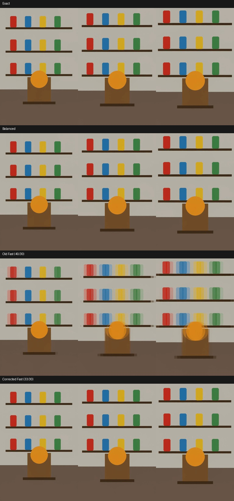
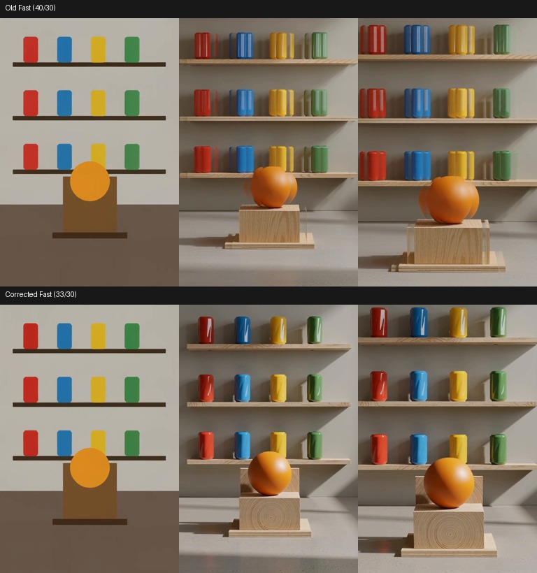
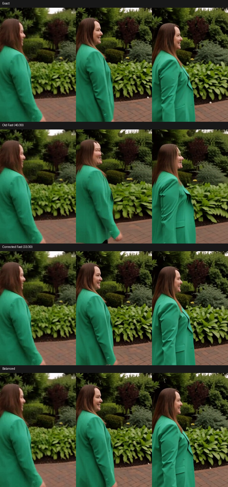

# H3 Fast token reduction: repeated-edge reproduction and correction

2026-10-11. M5 Ultra, 80 GPU cores. Fast alone reproduced repeated sideways
outlines and broken/banded shelf edges in an authored image-to-video fixture.
Balanced did not show that failure. No private input image was used.

## Cause and scope

The old Fast recipe restored full target-video tokens before block 40 during
its first ten model evaluations, then before block 30. On a ten-step,
single-evaluation-per-step Turbo run, **every evaluation used block 40**.
Balanced restores before 30/20 and also protects endpoint steps.

Holding the model, input, prompt, seed and sampler constant:

- Disabling our block glue fusions retained the visible failure. This was not a
  byte-identical comparison: video-latent relative L2 was 0.0267 versus fused
  Fast. It rules out those fusions as a necessary trigger, not every kernel.
- Protecting the first/final sampler steps while retaining restoration at 40
  still showed repeated outlines.
- Restoring before block 30 removed the failure. Additional short screens at
  32, 33, 34, 36 and 38 did not show the same gross repeated-edge failure.

This is a **preset correction**, not a newly repaired Metal indexing kernel.
The original within-pair detail retained by token reduction does not receive
independent updates during the merged span. Reintroducing it too late can
leave visible spatial artifacts. The previous RoPE, modulation-mask and packed
layout compatibility fixes remain present.

Fast now restores before **33/30**, preserving full tokens through the late
layers and retaining a margin beyond the clean short-screen boundary. Blocks
33–35 are also protected by our sparse presets; this experiment does not prove
that those three blocks alone caused the token artifacts. All-step coverage,
scale 1 and the first-ten-evaluations phase rule remain unchanged. The explicit
advanced controls remain available; saved advanced values are not rewritten.

## Short reproduction

768×1152, 22 frames at 24 fps, 10 steps, `res_multistep` / `simple`, seed 1,
INT8 convrot H3, FP16 video VAE, FP32 audio VAE. Standard LoRA loaders apply
DMAD four-step LoRA at 0.9 and Turbo v4 at 0.1. A procedural reference contains
three straight shelves, colored containers and an orange sphere. The prompt
asks for a slow camera move closer, stable edges and quiet room ambience.
Cache and sparse attention are off. Model loading and a two-step warmup are
excluded. These are single screening measurements, not repeated speed claims.

| Mode | Sampling | Complete execution | Visual observation |
|---|---:|---:|---|
| Exact optimized control | 26.154 s | 28.839 s | Clean outlines |
| Balanced | 21.527 s | 24.235 s | Clean outlines |
| Old Fast, 40/30 | 18.110 s | 20.786 s | Repeated outlines, banded edges |
| Old Fast, block fusions disabled | 19.186 s | 21.888 s | Failure remains |
| Restore at 30, all steps | 20.499 s | 23.216 s | Failure absent |
| Restore at 40, endpoint steps protected | 19.885 s | 22.587 s | Failure remains |
| Restore at 33, all steps | 19.628 s | 22.328 s | Failure absent |

The correction costs about 1.54 seconds in this screen, while remaining about
1.29× as fast as the exact optimized control. These figures are not stock
ComfyUI comparisons and do not replace the main benchmark table.

## Longer clip and second input

At 124 frames (5.17 seconds), the same geometric fixture again showed repeated
containers with old Fast. Corrected Fast kept one container per color in the
sampled sequence. Both outputs transition the flat illustration toward a 3D
appearance, so this is not an identity-preservation claim. Old/new sampling was
125.974 / 150.327 seconds; complete execution was 147.453 / 167.594 seconds.
These are single runs. The old run also paid conditioning work for the changed
sequence length; sampling is the cleaner cost comparison.

A second input was cropped from an earlier authored diagnostic render of a
woman walking through a garden. At 22 frames, seed 93742, old Fast produced
doubled facial features; corrected Fast and Balanced did not show that defect
in the sampled frames. They still differ from the control in motion, pose,
clothing and background detail.

| Second input | Sampling | Complete execution | Video-latent relative L2 vs exact | Frame PSNR vs exact |
|---|---:|---:|---:|---:|
| Exact optimized control | 26.098 s | 33.059 s* | 0 | — |
| Old Fast | 18.029 s | 20.692 s | 0.3947 | 19.29 dB |
| Corrected Fast, first | 19.588 s | 22.250 s | 0.3086 | 21.54 dB |
| Corrected Fast, repeat | 19.531 s | 22.194 s | 0.3086 | 21.54 dB |
| Balanced | 21.429 s | 24.156 s | 0.2871 | 22.01 dB |

*The second-input control includes fresh conditioning; do not use that E2E value
to claim a warm speedup. The corrected repeats have byte-identical video/audio
latents, decoded frames and decoded audio, with identical initial noise and
conditioning. Pixel-aligned errors are supplemental, not quality acceptance.

## Validation

The regression test exercises actual reduction/restoration wrappers, checking
that full token counts, original RoPE and original modulation segments have
returned by block 33, in both early and later phases and with odd-width rows.
It fails with the old Fast recipe and passes with the corrected one.

437 targeted CPU tests and two frontend tests passed. The isolated GPU server
used a 110 GiB process-RSS watchdog, a 48 GiB available-memory floor and an MPS
high-watermark ratio of 0.4. Peak sampled Metal driver allocation was 61.37 GiB;
peak process RSS was 12.16 GiB, a separate measure. The server was shut down
after the tests. Runtime source files were backed up, installed in both ComfyUI
copies and verified by SHA-256; the user's running server was not restarted.

[Per-run timings and tensor hashes](data/m5-ultra-h3-fast-token-fix.json).

Approximate modes still change outputs. A clean geometric fixture does not
establish universal preservation of identity, detail, motion or audio quality.
