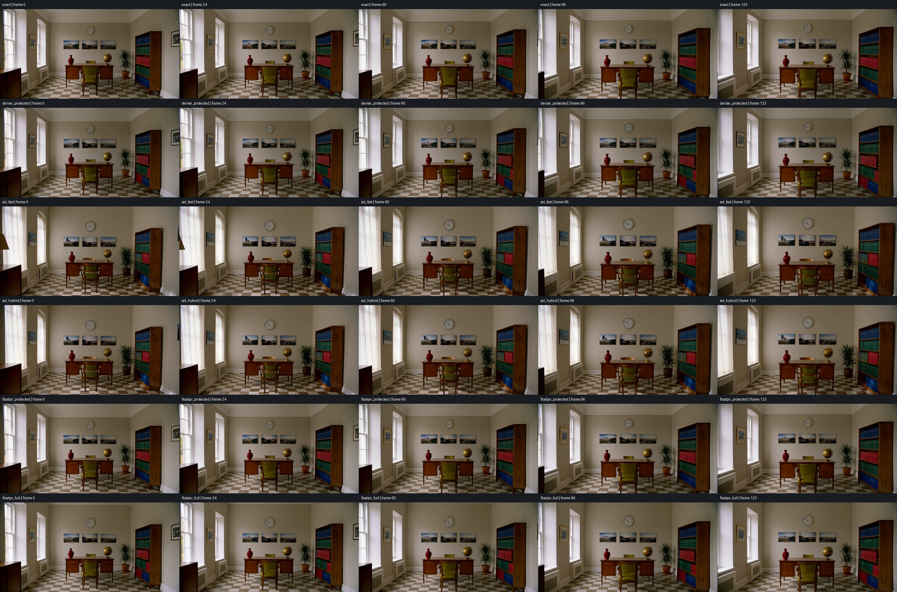
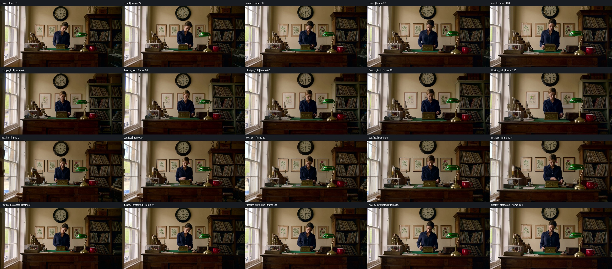

# H3 INT8 QK / floating PV — 1024×512, October 14, 2026

The new optional dense kernel trades some of full-INT8 attention's speed for
closer numerical agreement. **Exact dispatch and all existing recipes remain
unchanged.** It does not replace SOL as the fastest tested choice.

## Configuration and timing boundaries

- M5 Ultra, 80 GPU cores, 256 GB; macOS 27.
- ComfyUI v0.40.0 (`3541246a9c997f4b8c32f9f88f3c985d02021c79`),
  PyTorch 2.14.1, torchvision 0.29.1, Python 3.13.12.
- H3 INT8 diffusion weights, BF16 transformer attention, FP16 video VAE;
  1024×512, 124 frames at 24 fps (5.17 s), 20 steps,
  `res_multistep` / `simple`, CFG 1, no LoRA.
- Checkpoints: `minimax_h3_fl2va_pruned_int8_convrot.safetensors`,
  `qwen3vl_32b_minimax_h3_int8_convrot.safetensors`,
  `minimax_h3_video_vae_fp16.safetensors`,
  `minimax_h3_audio_vae_fp32.safetensors`.
- Cache, token reduction, Veda and the global relaxed preset off. Existing
  exact model and VAE optimizations remain enabled in every row.
- Joint attention shape `[1,56,19508,128]`: 18,944 video tokens plus 564
  text/audio tokens. Direct prefix queries are exact, rounded out to 576 rows.
- Authored study-room camera-push scene, seed 812764035. Every primary mode
  uses identical initial noise and conditioning, verified by tensor hashes.
- Six two-step warmups, then two full runs per mode in forward/reverse order.
  The protected windows are inactive at two steps, so their first full run
  can include first-use kernel work; the second full run is warm. Both are
  shown. This is not a cold-launch comparison.
- Sampling includes allocations, quantization, layout and all model work.
  E2E includes VAE decode and video export; diagnostic tensor saves/hashes are
  outside timing. Peak driver allocation was at most
  56.30 GiB. Isolated server with
  110 GiB RSS / 48 GiB available-RAM guards; no private media was used.

## Complete-clip results

| Attention mode | Sampling, runs 1 / 2 (s) | Warm run 2 s/step | E2E, runs 1 / 2 (s) | Mean E2E speedup |
|---|---:|---:|---:|---:|
| Exact optimized | 185.06 / 185.84 | 9.292 | 196.34 / 197.18 | 1.000× |
| Existing dense INT8 protected | 174.80 / 175.30 | 8.765 | 186.09 / 186.72 | 1.056× |
| Existing SOL INT8 Fast | 136.91 / 137.15 | 6.858 | 148.22 / 148.47 | 1.326× |
| Existing SOL INT8 Hybrid Fast | 135.77 / 135.99 | 6.799 | 147.10 / 147.28 | 1.337× |
| New INT8 QK / BF16 PV protected | 178.05 / 175.29 | 8.764 | 189.38 / 186.58 | 1.047× |
| New INT8 QK / BF16 PV full | 170.18 / 170.14 | 8.507 | 181.47 / 181.47 | 1.084× |

Across the two runs, the new full mode saves **15.29 s sampling**
and **15.28 s E2E** against exact in this workload.
It does **not** reach 8 s/step. The new protected mode favors closer output over
maximum speed. Its warm run essentially matches existing dense INT8 protected;
its first full run was slower, so there is no demonstrated speed advantage
over that preset. Its advantage here is closer output.
These measurements do not establish equivalence to an unverified Draw Things
8 s/step claim: its clip duration, exact checkpoint and settings are unknown.

## What changed

Adapted CCV's October 11 [`quantizePV=false` kernel](https://github.com/liuliu/ccv/commit/e499321b29b5c9c31329a8efc6960d84856d3315):
INT8 QK after Hadamard rotation and K centering, BF16 probability/value matrix
inputs, FP32 PV accumulation and FP32 softmax intermediates. All keys remain;
there is no sparse selection or cross-step reuse. Local BHSD input/output
addressing removes sequence-major layout copies. The shader's BSD notice and
source revision are retained in the package.

The captured full-shape operator screen, including allocations, quantization
and layout, measured medians across seven interleaved rounds of three calls:

| Operator | Time | Relative RMSE vs exact |
|---|---:|---:|
| Exact query-cache | 99.70 ms | 0 |
| Floating PV with layout copies | 89.37 ms | 0.461% |
| Floating PV with native BHSD | 82.59 ms | 0.461% |
| Existing dense INT8 | 81.75 ms | 1.559% |
| SOL INT8 Fast | 18.17 ms | 17.263% |

The newer upstream full-INT8 sequence-major shader screened at 75.32 ms;
that is an isolated operator result, not a validated new full-clip preset.
Fused QKV and FC1/SwiGLU variants were not changed or benchmarked in this pass.
They remain separate work, not part of these savings.

## Quality and temporal behavior

Primary scene, decoded tensors compared with exact:

| Mode | Frame RMSE, [0,1] | Frame cosine | Audio waveform relative RMSE |
|---|---:|---:|---:|
| Existing dense INT8 protected | 0.03506 | 0.996581 | 14.56% |
| Existing SOL INT8 Fast | 0.10630 | 0.968771 | 49.56% |
| Existing SOL INT8 Hybrid Fast | 0.10128 | 0.971475 | 52.46% |
| New INT8 QK / BF16 PV protected | 0.01211 | 0.999582 | 5.47% |
| New INT8 QK / BF16 PV full | 0.04909 | 0.993100 | 14.28% |

The protected floating-PV result is closest to exact in this comparison.
Full floating PV changes clock detail/size and some shading but retains the
room layout and camera push. Existing SOL Fast/Hybrid change more of the
window treatments, furniture and clock appearance. Those are differences
from the exact scene, not by themselves evidence of within-clip morphing.

Contact-sheet inspection across the 124-frame sequence found no obvious severe
background morphing or horizontal tearing in the new full mode or SOL Fast.
Keyframe comparisons support coherent geometry in the protected and hybrid
modes too. This is a limited scene-level inspection, not a quality guarantee
across prompts, durations or LoRAs. At 512×256 tracking resolution the exact
mean camera-compensated p90 residual was 0.0782 px;
new full was 0.0776 px. Flow residuals are only a warning metric:
parallax and differently generated details confound them.

### Second prompt and seed

An antique music shop with a woman turning a music-box handle, camera dolly,
rigid wall clock/frames/records, musical notes and ticking; seed 913602847.
The same resolution/frame/step settings were used. These are single quality
confirmation runs using the packaged backend, not timing-repeat claims.
Protected was confirmed in a separate fresh process after the full-mode scene
changes were observed; identical noise and conditioning hashes were checked
across those processes. Do not compare its cold E2E against the warm table.

| Mode | Frame RMSE, [0,1] | Frame cosine | Audio waveform relative RMSE |
|---|---:|---:|---:|
| New INT8 QK / BF16 PV full | 0.09914 | 0.967472 | 70.26% |
| Existing SOL INT8 Fast | 0.10488 | 0.963312 | 141.10% |
| New INT8 QK / BF16 PV protected | 0.03915 | 0.994994 | 93.08% |

Full floating PV preserves a coherent shop and camera move, but changes the
woman's pose/height in frame, the wall-picture arrangement and other details.
SOL Fast also changes pose, hand motion and details; full floating PV is not a
consistent perceptual winner over SOL merely because its operator error is
smaller. In this scene their decoded-frame errors are much closer than in the
study-room scene. The full mode remains **experimental**, not a replacement
claimed to preserve the original generation.

Protected retains the original pose and shop layout much more closely: frame
RMSE 0.03915 versus 0.09914 for full and 0.10488 for SOL Fast. The full-sequence
contact sheet shows coherent background geometry, without obvious tearing or
large background transformations. Hand motion/details still differ.

Audio agreement is **not monotonic with protection**: waveform relative RMSE
was 93.08% protected, 70.26% full and 141.10% SOL Fast on this music scene.
These are waveform differences, not listening scores; even modest phase or
note/timing changes can produce large errors. Neither new mode qualifies as
preserving exact audio, and the protected mode's closer video is not evidence
of closer sound. This limits the recommendation to an optional visually
conservative starting point, pending the user's audio/clip assessment.

Audio tensors were finite; waveform RMS/peak and errors are included in the
raw data. Audio changes despite direct-prefix protection. No listening-panel
or perceptual-audio validation was performed; numerical similarity does not
establish equal sound quality. Saved clips include their generated audio.

Contact sheets: [full mode, study room](artifacts/h3-floatpv/study-floatpv_full-allframes.jpg),
[protected mode, music shop](artifacts/h3-floatpv/secondary-floatpv_protected-allframes.jpg).

## Controls, safety and validation

In **H3 Acceleration Presets → Attention acceleration**:

- **Dense QK INT8 / PV BF16 · protected:** window 0.20–0.90, first four/final
  two of 20 steps exact; layers 0,1,33,34,35 exact.
- **Dense QK INT8 / PV BF16 · full experimental:** all steps/layers eligible,
  with exact prefix queries retained.

For the comparison above, cache and token reduction were Off. Existing default
and saved presets are untouched. Select attention Off for the exact route.
Both modes retain the 8192-token eligibility gate and Auto memory budget.
The kernel accepts M5 BF16 `[1,56,S,128]` with at most 65,536 tokens;
unsupported/masked/nonstandard-scale and over-budget calls use the existing
fallback. No quadratic score matrix is allocated.

The native layout adaptation and packaged backend were checked byte-for-byte
against the tested implementation, including the actual 19,508-token input,
ragged/strided inputs and exact-prefix output. This establishes implementation
parity **within this approximate mode**, not parity with exact attention.
All six primary modes reproduced their own latent, frame and audio hashes on
the second run; the final exact run recovered the initial exact hashes. The new
protected/full paths executed 630/1000 quantized attention calls respectively.
603 focused CPU tests and three quick-node UI tests passed. Per-run tensor
hashes, call counts, finite checks and native parity checks are in the data.

[Machine-readable measurements](data/m5-ultra-h3-floatpv.json) ·
[Controls](../docs/h3-acceleration.md#dense-int8-qk-with-floating-pv) ·
[CCV notice](../third_party/ccv-BSD-3-Clause.txt)
