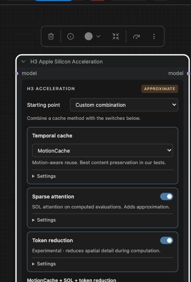

# H3 Nodes 2.0 UI and bundled accelerator validation

September 29, 2026 · M5 Ultra 80 GPU · PyTorch 2.14 · exact native kernels,
PyTorch attention, relaxed environment preset off.

## Scope

Replaced the old canvas controls with one DOM panel supported by ComfyUI's
`addDOMWidget` API. Hidden backend widgets retain their original serialization
order, with zero layout height in both renderers. New tuning inputs are appended;
existing workflow values remain valid. Settings are per mechanism, with independent
SOL and token switches and a choice of one temporal predictor.

MotionCache and Spectrum source is pinned and bundled unchanged. The node applies
the temporal predictor before token reduction and sparse attention, so computed
evaluations run the inner mechanisms and skipped evaluations bypass them. No
external custom-node package is needed. The isolated test server's custom-node
folder contained only this package. Reference implementations were loaded separately
for comparison. Attribution and license terms are in `THIRD_PARTY_NOTICES.md`.

## Runtime checks

864×480, **22 frames**, **20 steps**, res_multistep/simple, seed 812764035,
no Turbo LoRA, same prompt/noise/model/VAE. One 2-step warmup preceded the table.
SOL combination probes deliberately use tau **0.5** and minimum tokens **0**
to exercise attention on this short sequence; production SOL's first-enable
recipe remains tau 1.3, minimum 8192, protected layers 0,1,33,34,35,
step-fraction window 0.20–0.90.

These are single warm compatibility measurements, **not repeated full-clip
benchmarks or quality-qualified presets**. Adding sparse attention can cost time
on short clips, which is why the ordinary token guard remains enabled.

| Mode | Sampling incl. replay | End to end |
|---|---:|---:|
| Exact before combinations | 17.18 s | 19.00 s |
| Standalone MotionCache reference | 13.85 s | 15.68 s |
| Bundled MotionCache | 13.83 s | 15.64 s |
| MotionCache + SOL | 14.32 s | 16.16 s |
| MotionCache + token reduction | 10.92 s | 12.73 s |
| MotionCache + SOL + token reduction | 11.56 s | 13.38 s |
| Standalone Spectrum protected reference | 11.45 s | 13.31 s |
| Bundled Spectrum protected | 11.48 s | 13.42 s |
| Spectrum protected + SOL | 11.28 s | 13.09 s |
| Spectrum protected + token reduction | 8.33 s | 10.17 s |
| Spectrum protected + SOL + token reduction | 8.32 s | 10.14 s |
| Exact after combinations | 17.19 s | 19.03 s |

All outputs were finite. Bundled versus standalone MotionCache and Spectrum each
produced **byte-identical noise, sampler latents, decoded frames and decoded audio**.
Exact outputs before and after all combinations were also byte-identical.
This validates integration and state restoration; combined modes remain non-bit-exact
and require perceptual testing before recommending them as quality presets.

The watchdog used an RSS limit of 110 GiB and a minimum available-memory threshold
of 48 GiB. Peak sampled process RSS was 11.23 GiB; RSS is not a total GPU/unified
memory measurement. The recorded MPS driver allocation peaked at 52.38 GiB. The server's recorded exit -15 is its intentional shutdown.

Spectrum can replay sampling internally. The table uses the full `sampling`
timer, not `sampling_loop`, which would report only the final replay subpass.

[Raw metadata, workflow, candidate and comparison summary](artifacts/h3-node-v2/).
Previous [repeated full-clip timings and visual comparisons](m5-ultra-h3-recent-methods.md)
remain the basis for the standalone default recipes.

## UI checks

Verified in the actual ComfyUI frontend with Nodes 2.0 enabled: fresh node
placement, MotionCache-only default, first sparse enable initializing the measured
INT8 recipe, independent cache/SOL/token changes, Exact reset, editing numeric
settings, saving and reloading with those values and expansion state preserved.
The same panel renders in the classic canvas. Backend widget order remains 24
existing fields followed by 7 new tuning fields; presentation controls are not
serialized as backend inputs. Python integration and JavaScript controller tests:
13 + 12 passing.

