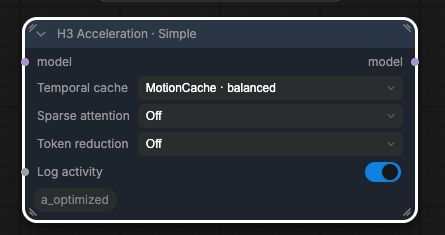
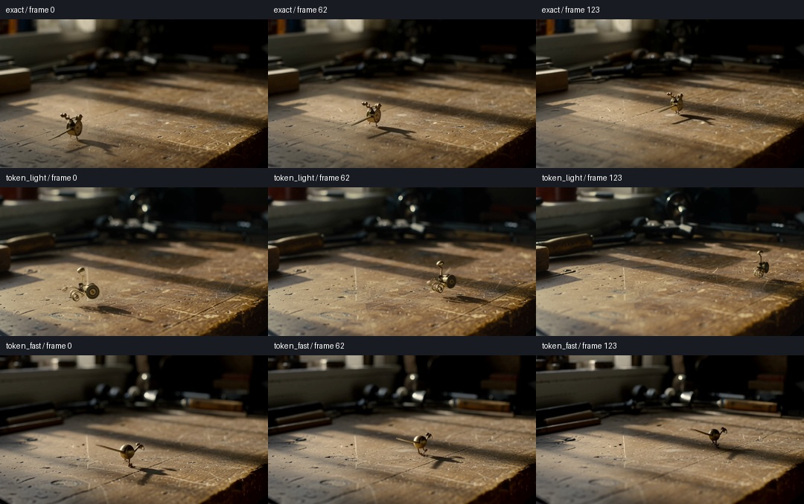
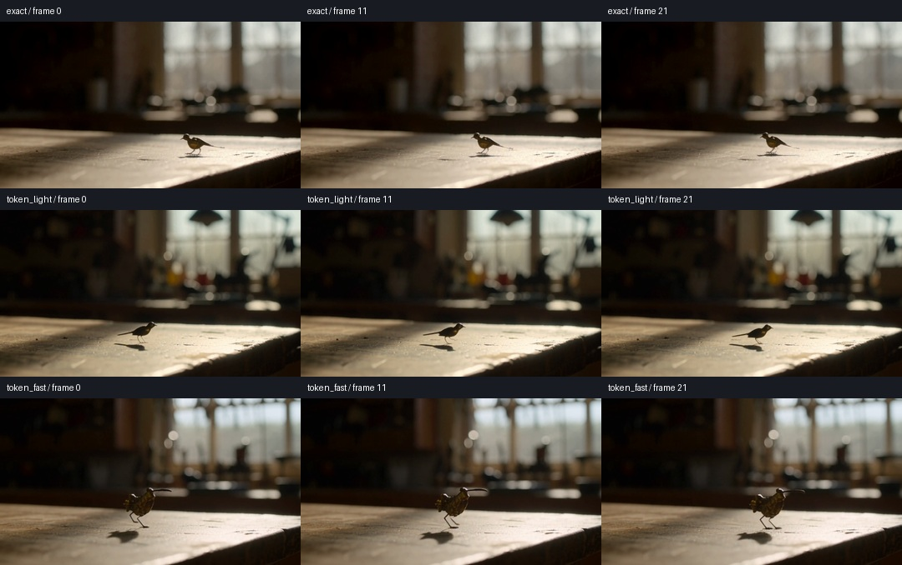

# Compact H3 presets and token-reduction compatibility

M5 Ultra **80 GPU cores**, 256 GiB, PyTorch 2.14 / the existing exact optimized
stack. Date: 2026-10-06. This adds a small control surface and fixes token
integration; it does not replace matrix-multiply or attention kernels.

## Interface

**H3 Acceleration · Simple** has three independent standard dropdowns and a
logging toggle. Both node renderers use ComfyUI's own widgets, retaining normal
workflow serialization and primitive connections. MotionCache, FirstBlockCache,
Spectrum, Veda and token reduction each have two recipes; SOL has three. The
existing advanced node remains available and saved workflows keep their values.
The new default is MotionCache balanced alone, with tokens/sparse off.

[Complete recipe values](../docs/h3-acceleration.md#simple-node) ·
[Single-node template](../workflows/h3_acceleration_simple.json).

## Reproduced faults and corrections

1. A synthetic native per-token modulation vector reproduces the old reducer's
   `ValueError: only one element tensors can be converted to Python scalars`.
   The old reducer also required one scalar final-video modulation segment.
   It now accepts tensor indices and multiple contiguous target-video segments.
   Pair-compatible masks retain their modulation at reduced width. If horizontal
   partners have different timesteps, the evaluation uses full tokens and logs
   why rather than mixing conditioning strengths.
2. Veda checked its query length against an unchanged full packed layout. In the
   four-step reduced test, **144 of 200 calls** fell through as `other attention`.
   It now receives a private reduced layout with matching spans, grid and position
   count. Both Veda metadata and SOL counts restore on expansion or interruption.
   The conditioning layout remains unchanged.
3. Scalar-only normalization fusions tried converting a supported per-token
   modulation vector to an integer and could latch the fusion off globally.
   They now decline that input normally and remain available for later scalar
   modulation. This keeps the existing kernel implementation untouched.
4. Token logging now reports actual reductions, row counts and mask bypasses,
   rather than merely reporting that the mode was enabled.

No user workflow, image or clip was opened. The test uses authored prompts,
seeded noise and synthetic diagnostic masks. These reproduce concrete
compatibility faults; without the user's original error they do not establish
which fault occurred in their workflow.

## Measurements

The authored prompt depicts a brass clockwork bird on a workbench, with quiet
workshop audio. Resolution **864×480**, seed **812764035**, sampler
**res_multistep**, scheduler **simple**, **20 steps**, no Turbo LoRA, same model,
conditioning and noise across controls/presets. Native INT8 convrot DiT/text
encoder, FP16 video VAE, FP32 audio VAE. `ASFP8_MINIMAX_RELAXED=0`.

One-second checks use **22 frames**, about 0.92 s at 24 fps. Cold model/graph
warmups are excluded. The table includes full sampling and complete prompt
execution, rather than an isolated matrix multiply or denoiser sub-loop.

| Token mode | Warm sampling, median | Complete execution, median | Sampling time saved |
|---|---:|---:|---:|
| Off | 16.550 s | 18.332 s | — |
| Light | 14.992 s | 16.786 s | 9.4% |
| Fast, original 40/30-block policy | 12.423 s | 14.226 s | 24.9% |

Off has three measured runs; Light and Fast each have two. Both token presets
reduce **2938 → 1573 packed rows** at block 4 on all 20 evaluations. Light
restores before block 20 during the first ten evaluations and before block 12
later; Fast uses block 40/30. Every mode's repeated final latents, decoded
frames and audio are byte-identical to its own repeat. The all-Off controls
before and after the synthetic-mask checks match, confirming cleanup.

A frame-aligned mask completes with **20/20 reduced evaluations**. A synthetic
mask splitting horizontal pairs completes with **0/20 reduced evaluations**, logs
the reason and produces exactly the same latents, frames and audio as its
unreduced masked control.

The first independent cache recipe screen on the same one-second 20-step prompt
completed all six cache presets. Sampling: MotionCache protected **13.337 s**,
balanced **11.707 s**; FirstBlockCache protected **12.604 s**, fast **9.519 s**;
Spectrum protected **11.140 s**, fast **9.456 s**. These are single short-screen
runs, not new quality qualifications. SOL/Veda retain the prior full-clip recipe
measurements; the Simple node does not change those kernels or numerical settings.

### Five-second confirmation

Same authored prompt/noise and decoder, **124 frames** (5.17 s), 864×480,
20 steps. These are single token runs bracketed by two warm exact controls;
the repeatability check above is at the full 20 steps on the short clip.

| Token mode | Sampling | Complete execution | Sampling time saved |
|---|---:|---:|---:|
| Off, first control | 130.591 s | 141.736 s | — |
| Light | 112.649 s | 123.769 s | 13.7% |
| Fast | 83.575 s | 94.701 s | 36.0% |
| Off, final control | 130.545 s | 141.610 s | — |

Savings use the mean of the two controls. Their decoded frames, video/audio
latents and audio tensors match byte for byte. Light saves about **18 s** and
Fast about **47 s** of complete execution on this prompt. Both reduce
**15428 → 8213 packed rows** in each of 20 evaluations. These are approximate
outputs and do not replace the exact top-level benchmark with another prompt.

The five-second contact sheet also shows clear subject changes: Light turns the
bird into a wheeled mechanism; Fast produces a simpler rounded metal bird.
The target remains a small brass object on the workbench, but neither keeps the
control's identity or trajectory. A speed result is not a quality acceptance.

### Sparse combinations

The normal presets keep a minimum of **8192 tokens**; this short clip is below
that threshold. Separate SOL/Veda integration checks set it to **zero** to
exercise the reduced geometry. They are not the normal compact-node setting.

At four steps, old/new token-only, MotionCache+token, Spectrum+token and SOL+token
latents, frames and audio match byte for byte. SOL+token's first new kernel run
must be treated as compilation/warmup, not a speed claim. Veda+token now actually
uses its approximate kernel inside the reduced span and therefore changes the
old combination's bytes. It was **slower** on the short clip: four-step sampling
**3.894 s**, versus token-only **2.556 s**; its one-second 20-step sampling was
**16.859 s**, versus token-only **12.446 s** in that screen. This combination is
available but is not recommended as a shortcut. Sparse plan/predictor overhead
and shorter rows can erase the gain.

## Quality

Token reduction remains **experimental and off by default**. On the one-second
prompt, both recipes change the bird's orientation, scale and background;
Fast produces a larger, more stylized bird. Light is less aggressive in block
coverage, not a guarantee of closer output. Decoded-frame PSNR is **18.37 dB**
for Light and **18.79 dB** for Fast; neither establishes quality preservation.
Frame-to-frame difference error is 0.02261 / 0.02511 RMSE respectively. The short
contact sheet shows composition changes; it cannot establish long-video motion
or audio quality. Compare the retained generated videos as well.

## Installed-copy check

A second authored red-kite/coastal-cliff prompt and seed **92745123** completed
20 steps at 22 frames through the **installed ComfyUI 2.14 pack**. Sampling was
**16.595 s** exact, **15.025 s** Light, **12.483 s** Fast. All captured tensors were
finite, and both token recipes performed 20 actual reductions. This is another
short compatibility/performance check; it is not a quality qualification.
Installed source hashes were verified against the workspace and earlier files
were backed up. The user server was not restarted.

## Validation and limits

- CPU/regression suite: **230 passed, 11 MPS-only tests skipped**.
- Frontend tests: **16 passed**; Nodes 2.0 was checked in the actual local UI,
  including independent selector changes and default placement.
- Broader MPS suite: **197 passed, two direct GPU byte-equality checks failed**.
  The same two failures reproduce with the unchanged scalar `_seg_rows` code:
  `test_gate_norm_mod_and_final_gate_match_eager_bf16` and
  `test_final_layer_f32_graph_kernel_matches_eager_rounding`. This pass does not
  claim to resolve or re-certify those existing kernel-vs-eager discrepancies.
  Matched existing four-step complete outputs remain byte-identical before/after
  the edits, and the new masked bypass matches its exact control.
- Memory guard: maximum 110 GiB process RSS, minimum 48 GiB available RAM, MPS
  high/low watermarks 0.4/0.3. Peak process RSS for the one-second validation was
  about 15.4 GiB; the five-second run peaked at **13.0 GiB process RSS**.
  These are not total unified GPU/CPU residency.
- Initial diagnostics containing a wrong SOL backend spelling, and repeats
  after a diagnostic-only mask cleanup mistake, were excluded and rerun. Full
  accepted data records the exclusions and retains their original provenance.

[Raw runs, numerical errors, recipe settings and guards](data/m5-ultra-h3-presets.json).
