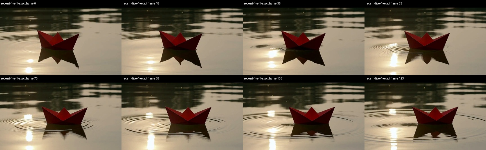
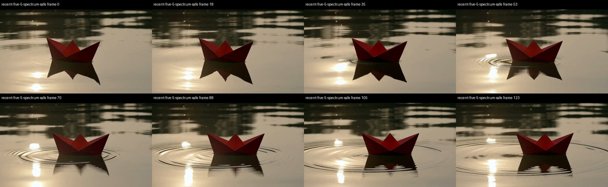
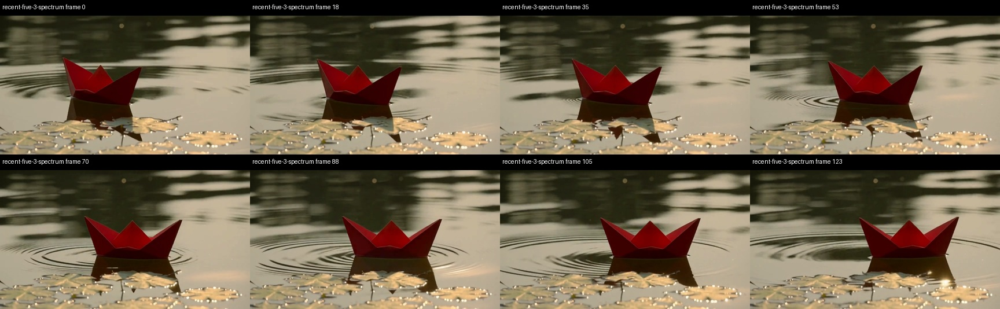
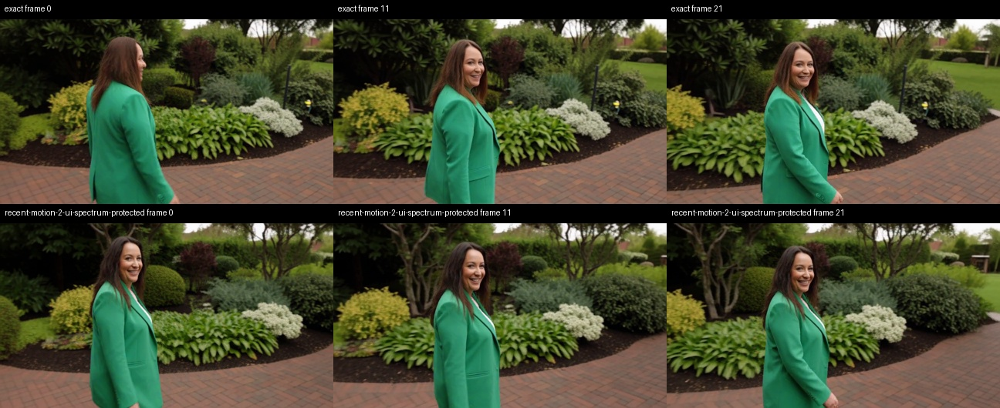
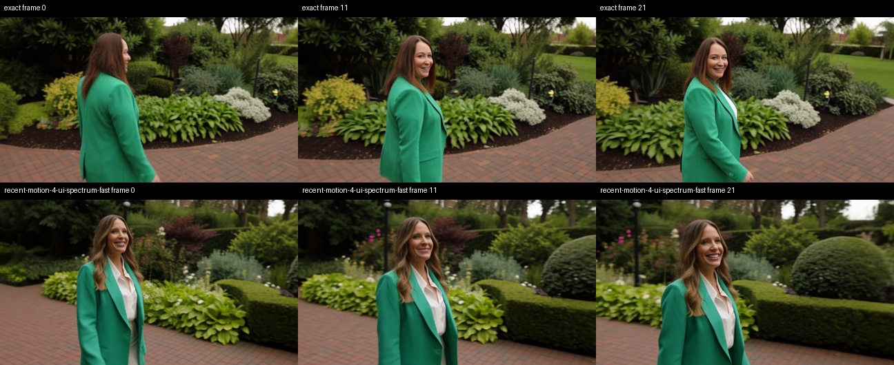
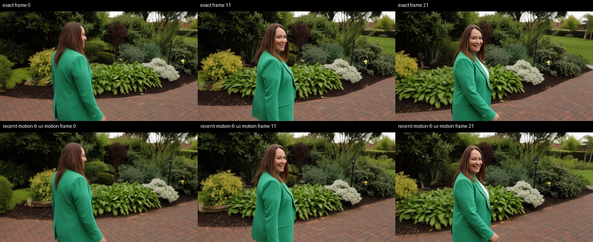

# H3 acceleration survey and M5 Ultra tests — September 29, 2026

> Integration update: MotionCache and Spectrum are now bundled in the H3 node,
> with independent SOL/token switches and a Nodes 2.0 panel. Historical results
> below are unchanged. See [current controls](../docs/h3-acceleration.md) and
> [integration validation](m5-ultra-h3-node-v2.md).

Hardware: M5 Ultra, 80 GPU cores, 256 GB unified memory; macOS 27,
PyTorch 2.14. The reference is our existing optimized, exact H3 path, not
vanilla ComfyUI. The older relaxed environment preset is disabled.

## What changed since August

The [community index](https://github.com/wildminder/awesome-minimax-H3)
was used to find projects; implementations and release notes were checked
in each project's own repository. An “acceleration” tag is not evidence
of an MPS speedup or compatibility with our INT8 checkpoint.

| Method | What it changes | Local outcome / next requirement |
|---|---|---|
| [Spectrum H3](https://github.com/xmarre/ComfyUI-Spectrum-MiniMax-H3) v0.2.28, September 18 | Chebyshev/ridge forecasting skips selected transformer evaluations; sampler-aware replay | Runs with our Metal kernels on MPS. Two optional presets integrated in the existing acceleration node. Original Spectrum research predates September; this is the recent H3 integration. |
| [SPEED v2](https://github.com/StanLukuvka/ComfyUI-MiniMax-H3-SPEED), September 20 | Progressive spatial grids and DCT expansion; full-resolution audio; RES history reset at transitions | Runs on MPS without a CUDA port. Calibrated our checkpoint and RES sampler; tested the complete pipeline. |
| [MotionCache](https://github.com/starsFriday/ComfyUI-MiniMax-H3-MotionCache), August 4 | Motion-weighted reuse of full model residuals | Tested separately from our FirstBlockCache. Existing August method, not a new September release. |
| [FastVAE fork](https://github.com/Mozer/ComfyUI-MiniMax-H3-MotionCache-FastVAE), August 15 | Batch spatial VAE tiles | Rejected: current ComfyUI already batches tiles; older blend semantics change pixels without a meaningful decoder improvement. |
| [VDN-H3](https://github.com/OpenVDN/vdn-minimax-h3), September 6 release / September 17 paper | Trained frame-wise linear attention branch plus softmax branch and adapters | Promising larger project. Released Diffusers/SGLang implementation relies on CUDA attention; needs model integration and MPS kernels. No local timing claimed. |
| [Veda H3 preview](https://huggingface.co/Veda-Sparse/Minimax-H3-T2VA-Veda-8NFE-600Step-Preview) | Learned tile-selection predictor, sparse attention, eight-evaluation model recipe | Needs a loader and efficient MPS sparse execution. Released tile plans do not cover our 864×480 / short-clip geometry. No local timing claimed. |
| [FastH3Patcher](https://github.com/Nynxz/ComfyUI-FastH3Patcher) | Learned AdaLN patch, optional VSA gates, eight-step recipe | Requires new weights and separate validation on INT8 convrot; not a generic exact kernel improvement. Not benchmarked here. |
| [PDD-Acc](https://github.com/Jalen-Brunson/ComfyUI-MiniMax-H3-PDD-Acc) | Trained multi-timestep prediction and head bank | Needs the supplied head bank and schedule; ordinary LoRA loading is insufficient. Not benchmarked here. |
| [RefDelta Solver](https://github.com/xmarre/ComfyUI-MiniMax-H3-RefDelta-Solver) | Checkpoint-specific sampling | Requires its RefDelta checkpoint; not applicable to this FL2VA reference unchanged. |
| [MiniMaxH3-Cache](https://github.com/lihaoyun6/ComfyUI-MiniMaxH3-Cache) | EasyCache-style reuse | Core patching, not a new MPS kernel. Source review only; existing FirstBlockCache remains available. |
| [T8 block cache](https://github.com/T8mars/comfyui-minimax-h3-blockcache-T8), [TE-Speed](https://github.com/HELPMEEADICE/TE-Speed-MiniMaxH3-OSS) | Transformer reuse | Overlap with our tested FirstBlockCache; TE-Speed also patches core. Not substituted blindly. |

TensorRT, CUDA-only sparse kernels and multi-GPU distribution do not provide
an Apple GPU implementation. Streamed/chunked generation mainly addresses
memory or changes generation context. Their advertised timings are not used
as estimates for this machine.

## Measurement contract

Same pruned FL2VA INT8 convrot checkpoint, FP16 video VAE, FP32 audio VAE,
864×480, 20 steps, `res_multistep` / `simple`, seed 812764035 and red-boat
prompt as the earlier campaign. Short screening uses 22 frames; the full
comparison uses 124 frames at 24 fps. No Turbo LoRA in these measurements.
Model loading is warmed up and text encoding cached. Sampling, both decoders
and video/audio export are included in E2E. Spectrum's cheap replay pass is
included in **complete sampling** time; its final inner-loop timer alone
would falsely imply near-zero sampling time.

Exact runs before and after approximate modes check for state leakage. Every
output is checked for finite values. Captured latents, decoded frames, audio,
noise, timing records, settings and source hashes are kept in the local
`diagnostics/h3-recent-methods` directory. Tests run serially with a 48 GiB
available-memory floor, a 110 GiB server-RSS cutoff and a one-hour campaign
limit. VAE-only tests use an 80 GiB RSS cutoff. No user server was restarted.

SPEED uses `coupled_full_grid` for a shared full-resolution initial-noise
field. It still changes spatial geometry and trajectory; this is not an
identical-latent method. Calibration is performed at the tested model,
sampler, step count and geometry. Its one-time full-resolution harvest is
reported separately, not charged to every subsequent render.

## Settings

Spectrum **protected**: first four and last two evaluations actual,
bootstrap off; **fast**: upstream first/last one actual and bootstrap on.
Both use blend 0.5, degree 1, ridge 0.1, window 2, flex 0.75, eight history
entries, replay on, audio blend 0, and device-resident (`vram`) history and
archive. On this machine `vram` means MPS unified memory. It is a device
placement choice, not an additional quality optimization. Audio can still
change through coupling to the changed video predictions.

MotionCache: threshold 0.15 (also screened 0.25), motion strength 1, warmup
4, maximum two consecutive skips, percent window 0.15–0.95, subsampling 8.
SPEED: three stages, RES multistep, delta 0.01, with measured calibration
parameters. Two-stage and delta 0.005 variants were also screened.

## Repeated full-clip results

| Method | Warm E2E runs | Mean E2E | Complete sampling | Less total time |
|---|---:|---:|---:|---:|
| Exact optimized reference | 143.240 / 142.667 s | **142.95 s** | 131.74 s | 0.0% |
| Spectrum fast | 84.055 / 84.210 s | **84.13 s** | 72.97 s | 41.1% |
| Spectrum protected | 97.355 / 97.262 s | **97.31 s** | 86.13 s | 31.9% |
| MotionCache 0.15 | 103.495 / 103.568 s | **103.53 s** | 92.35 s | 27.6% |
| SPEED, calibrated 3 stages / delta 0.01 | 110.872 / 110.439 s | **110.66 s** | 99.43 s | 22.6% |

Each candidate repeated with byte-identical latents, decoded frames and audio.
The final exact run also recovered all exact reference bytes, including the
previous campaign’s saved exact outputs. Peak sampled
Metal allocation was 57.31 GiB; maximum sampled server RSS was 11.14 GiB.
No OOM occurred.

The existing FirstBlockCache 0.20 preset previously measured 87.83 s. Spectrum
fast is only about **4.2% faster than that previous approximate preset**; its
41.1% figure is against today's exact reference. Different approximation
strengths and different days mean this is context, not a matched quality claim.

SPEED calibration took 142.80 s once, generating the exact decoded clip.
The residual fit gave A=19.0257753642, beta=0.8798802353, R²=0.7977. The saved
fit report labels delta 0.005; the A/beta regression does not use delta. We
explicitly tested delta 0.01 for transition scheduling and saved that setting
in the example workflow.

[Raw results, hashes and numerical metrics](data/m5-ultra-h3-recent-methods.json).

## Short screening

| Mode | Warm E2E | Complete sampling | Full transformer evaluations |
|---|---:|---:|---:|
| Exact, before/after mean | 18.99 s | 17.18 s | 20 |
| Spectrum fast | 11.68 s | 9.75 s | 11 |
| Spectrum fast, replay off | 11.40 s | 9.60 s | 11 |
| Spectrum protected | 13.22 s | 11.41 s | 13 |
| MotionCache 0.15 | 15.62 s | 13.81 s | 16 |
| MotionCache 0.25 | 14.80 s | 12.98 s | 15 |
| SPEED, calibrated 3-stage / delta 0.01 | 15.47 s | 13.64 s | 20, on varying grids |

Approximate rows above are single screening runs. Default Spectrum noticeably
reframes/shrinks the boat; the protected schedule retains composition better.
SPEED produces a sharp image but substantially changes camera/boat geometry
and reflection. These are not quality-preservation guarantees.

## VAE batching investigation

Repeated decoding of identical saved latents isolates the decoder. Native
124-frame decode takes 10.18–10.20 s. The external FastVAE node takes
10.41–10.44 s at batch 2, 10.17–10.20 s at batch 4, and 10.02 s once at batch
8. It changes decoded pixels even at batch 1: max absolute error 0.33093,
RMSE 0.003569 on the five-second clip. All its tested batch sizes produce
the same changed hash, locating the issue beyond batch-size arithmetic.

Current core blends against already blended neighbours; the older FastVAE
fork retains raw tile tails before blending. At crossing overlaps these are
different algorithms. Core already batches through `_decode_tile_row`.
The legacy opt-in batching flag in our package shared the old replacement
loop. On current core it now overrides **only tile-row scheduling**, retaining
core's native blend and temporal/output logic. Default behavior is unchanged.

## Reproduction and installation

The two Spectrum choices and `motion_cache` appear under **Cache Setup** in **H3 Apple Silicon
Acceleration**. Disable Token Reduction and Sparse Attention when using them;
unvalidated combinations are rejected. Connect after any model/LoRA loader.
The exact route remains Cache Setup disabled, Token Reduction off, Sparse
Attention off. Existing workflows retain their settings.

Spectrum, MotionCache and SPEED are separate dependencies, not copied into this package.
Spectrum is GPL-3.0-or-later; SPEED uses PolyForm Noncommercial 1.0. MotionCache is MIT licensed. Their own
licenses continue to apply. Pinned tested revisions:

- Spectrum `5161f0457bc8c52535212d6783eee73f439e1537`.
- SPEED `3ca5471e30508beb41a47589d7d58ac25bec0c80`.
- MotionCache `bc2894102b2486661884371259a27080b0b137bf`.
- FastVAE fork `b719329e0ecf35f0ae08d241c363ed1e56adbb95`.
- Community index `3e99dbd115b2280c15e7572fcea0c43f62a8e1a4`.

## Full-clip visual and numerical assessment

The same seed does not imply the same composition after an approximation.
PSNR measures alignment to the exact output, not aesthetic quality or prompt
adherence. Relative L2 is `norm(candidate-reference)/norm(reference)`.

| Candidate | Frame PSNR | Video-latent relative L2 | Decoded-audio relative L2 |
|---|---:|---:|---:|
| Spectrum fast | 14.36 dB | 0.6506 | 0.9653 |
| Spectrum protected | 23.28 dB | 0.2006 | 0.6664 |
| MotionCache 0.15 | 31.30 dB | 0.0775 | 0.5764 |
| SPEED 3 / delta 0.01 | 10.39 dB | 0.8828 | 1.0011 |

- **Spectrum protected:** retains the boat's framing, background and warm
  palette substantially better than the fast preset. Ripples, reflections and
  some boat details still change.
- **Spectrum fast:** adds foreground leaves absent from the reference and
  changes the boat's shape and placement. Sharp sampled frames are not proof
  of preserved content.
- **MotionCache:** closest visual match among these tested settings; retained
  boat geometry, scene and ripple progression in the sampled sequence. This
  is a useful slower alternative, not evidence that any reuse threshold is
  safe for every prompt.
- **SPEED:** changes camera framing, lighting and visible pond bed; the boat is
  partly outside the first frame. A different noise/grid trajectory explains
  much of this. It remains experimental, not a preservation preset.

Eight evenly spaced frames were inspected across each full clip. They show
coherent boat/ripple progression, but do not certify absence of inter-frame
flicker. Original clips retain their audio; the three-column comparison is
silent. Audio numbers establish waveform differences only. Listening quality,
speech/lip synchronization and long-clip quality are not validated here.

## What to test next

For immediate use, compare the protected Spectrum and MotionCache workflows
on the actual content you care about. The fast Spectrum option prioritizes
speed and accepts larger changes. Existing FirstBlockCache/SOL options remain
available; this is not a replacement for the exact path.

For a larger *new* kernel project, investigate Veda's learned block selection
against our Metal sparse attention, including predictor cost and supported
geometry; separately, VDN needs its trained linear-attention branch and model
integration. Neither is a drop-in flag. Start with standalone arithmetic and
weight-conversion checks, then complete eight-step clips against each trained
model's own reference. Their CUDA results cannot predict M5 Ultra timings.

The current measurements do not validate stacking Spectrum, SPEED,
MotionCache, FirstBlockCache and SOL. They also do not validate the 4/6/8-step
Turbo LoRA case: changing to a trained few-step schedule changes what can be
skipped and what calibration is appropriate.

## Comparison files and ready workflows

[Silent three-column video: exact / protected / fast](artifacts/h3-recent-methods/spectrum-five-comparison.mp4).
Original clips with their generated audio:
[exact](artifacts/h3-recent-methods/recent-five-1-exact.mp4),
[Spectrum protected](artifacts/h3-recent-methods/recent-five-5-spectrum-safe.mp4),
[Spectrum fast](artifacts/h3-recent-methods/recent-five-3-spectrum.mp4),
[MotionCache](artifacts/h3-recent-methods/recent-five-7-motion0.15.mp4),
[SPEED](artifacts/h3-recent-methods/recent-five-9-speed3-cal01.mp4).

Load a visual `.json` into ComfyUI, or submit the corresponding `.api.json`
through its API:

- [Exact reference](../workflows/h3_exact.json).
- [Spectrum protected](../workflows/h3_spectrum_protected.json).
- [Spectrum fast](../workflows/h3_spectrum_fast.json).
- [MotionCache 0.15](../workflows/h3_motion_cache.json).
- [Calibrated SPEED](../workflows/h3_speed3.json).
- [SPEED calibration](../workflows/h3_speed_calibration.json).

These use the tested local checkpoint names; adjust paths if your model
subdirectories differ. This machine has the upstream dependencies and updated
adapters installed in the 2.14 ComfyUI install. Restart ComfyUI and refresh its
browser to load the new choices. Shared-folder copies use the
`apple_silicon_h3_` filename prefix. No default approximation is enabled by
installing these dependencies.

## Additional prompts and public-preset validation

Two extra seeds use a blue ceramic cup/steam/linen scene (431927) and a woman
walking and turning in a garden (957130), each 22 frames and 20 steps.
Exact controls take 18.9 s. Candidate timings below are screening runs,
not full-clip estimates.

| Short case | Candidate | E2E | Frame PSNR vs exact |
|---|---|---:|---:|
| texture | Spectrum protected | 13.27 s | 27.38 dB |
| texture | Spectrum fast | 11.47 s | 14.29 dB |
| texture | MotionCache | 13.06 s | 31.79 dB |
| texture | SPEED | 15.41 s | 11.41 dB |
| motion | Spectrum protected | 13.25 s | 19.41 dB |
| motion | Spectrum fast | 11.46 s | 13.44 dB |
| motion | MotionCache | 15.59 s | 25.11 dB |
| motion | SPEED | 15.42 s | 12.92 dB |

Across both cases, every public Spectrum/MotionCache preset produced identical
latents, decoded frames and audio to its directly invoked upstream counterpart.
Both final exact controls restored all reference bytes. All outputs were finite.

The protected Spectrum cup remains close in framing and texture; fast Spectrum
changes the cup appearance and table background. In the garden, protected
Spectrum changes the head-turn timing, while fast Spectrum changes appearance,
clothing and scene composition. MotionCache stays closest in these sampled
frames. This multi-prompt result is why none is presented as unchanged quality.

## VAE fix validation and checks

The corrected tile-row adapter passed **all 18 saved-latent decodes** at
22 and 124 frames: batch sizes 1, 2, 4 and 8 retain identical final decoded
bytes, including repeated native controls. Full-clip batch 8 averages
**10.046 s**, versus native **10.222 s**, only **0.176 s saved**.
This is useful as a compatibility fix, not a material new E2E accelerator;
the batching override remains optional and off by default. It no longer
substitutes the old overlapping-tile algorithm on current ComfyUI.

Targeted validation: **27 Python tests and 9 frontend tests passed**, plus
real MPS sampler/decoder runs and public-adapter byte comparisons above.
The VAE worker completed successfully (exit 0) with all 18 records; its
watchdog hit a process-exit/RSS-sampling race after completion. The watcher
now handles that exit race. No memory cutoff or OOM occurred.

Installed-node registration passed in an isolated server; six visual/API workflow pairs have validated connections. Source backups and install hashes are retained locally.
