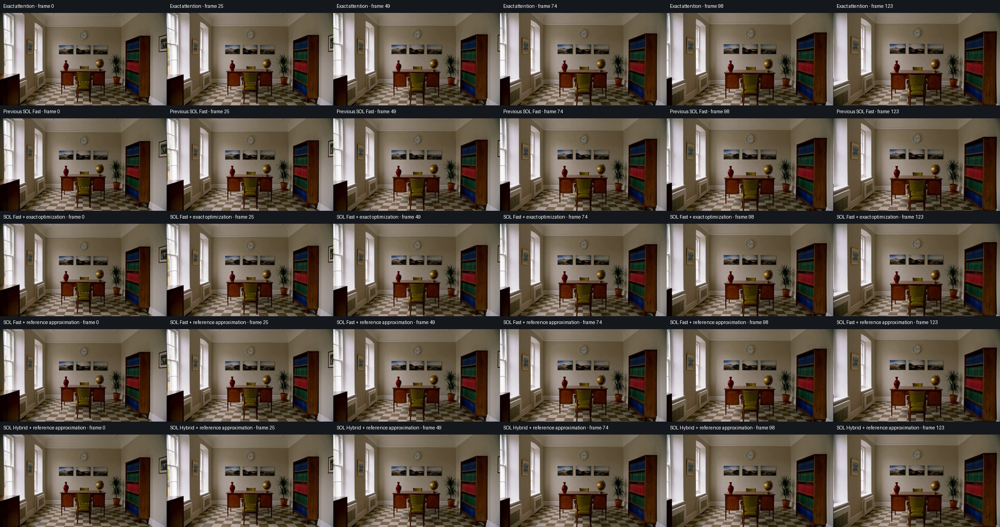
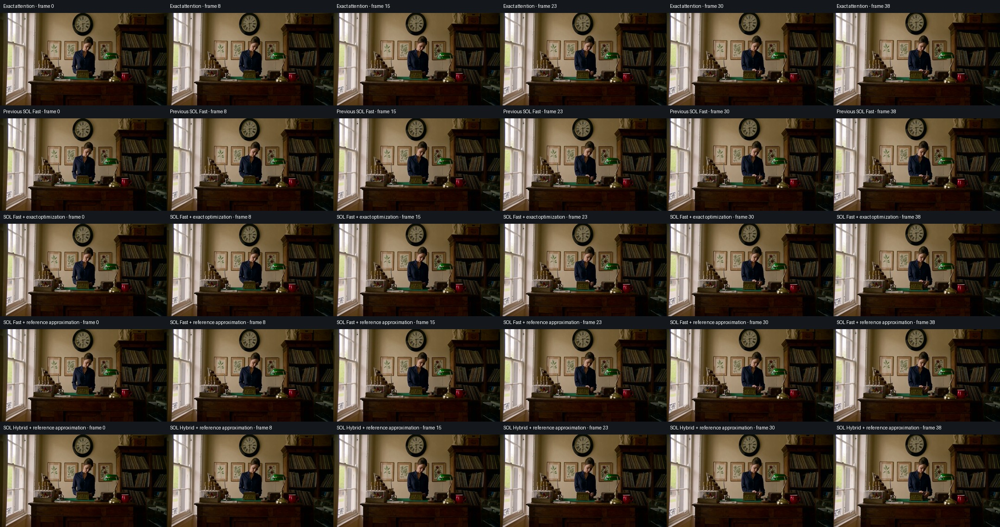
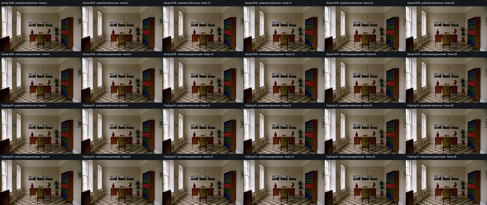

# H3 reference/guide attention — October 17, 2026

Two independent changes:

1. An **exact rectangular query-cache** for SOL's protected prefix on validated
   M5 / PyTorch 2.14.1 configurations. Same attention arithmetic and output bytes;
   `ASFP8_H3_PREFIX_QCACHE=0` restores native SDPA for comparison.
2. A **default-off visual-reference approximation switch** for SOL INT8, including
   hybrid and top-k. It extends existing SOL routing to visual guide/reference
   tokens. Text/audio queries and keys remain protected, as do outward-rounded
   boundary tiles. Preset step/layer guards are unchanged. Hybrid protected-layer
   dense INT8 calls retain their original prefix protection.

The exact optimization preserves **the existing SOL result**. SOL itself remains
approximate relative to all-exact attention. The new switch adds approximation;
exact protected audio rows do not guarantee identical final sound, because other
rows affect later layers.

## Why guided workflows saw little benefit

A full-video guide can occupy roughly half the joint sequence. The old policy
keeps every prefix query exact and every prefix key dense. A half-length prefix
therefore protects approximately 75% of the attention matrix. Sparsity measured
on the remaining target-video quadrant does not translate into the same fraction
of whole-model work saved. Quantization, routing and matrix/layout costs remain.

The new switch uses H3's actual packed segment map. `cond` and `ref_img` become
eligible along with `video`; `text`, `audio`, `cond_audio`, `ref_audio`, padding and
unknown kinds remain protected. Missing, stale or changed layouts retain the old
prefix policy. Reduced-token spans therefore fail closed when their lengths no
longer match the native layout. Pure text-to-video keeps the previous policy.

## Configuration

M5 Ultra 80 GPU / 256 GB, macOS 27.0.1, ComfyUI **v0.41.2**, PyTorch **2.14.1**.
H3 INT8 ConvRot diffusion/text encoder, FP16 video VAE, FP32 audio VAE;
864×480, Euler/simple, CFG 1, ten steps, no LoRA, cache or token reduction.
All existing model/VAE optimizations stay enabled. No private media was used.

The guide is a completed, previously authored 20-step study-room clip with a
camera push, wall clock, framed photographs, bookshelf, plant, vase, globe and
checkerboard floor. Short screening uses 39 frames (1.625 seconds), enough to
activate the unmodified 8,192-token SOL minimum. The full comparison uses 124
frames (5.17 seconds) plus a 1440×736 image reference derived from the same
benchmark scene. It exercises full-video conditioning and image references,
not the BFS shot-planning node or personal character-swap material.

Warm timing includes allocation, quantization, layout work, complete sampling,
VAE decode and export. Cached conditioning avoids re-encoding the guide on repeat
runs. Diagnostic tensor copies/hashes are outside timing. Exact warmup uses two
steps for the full comparison; all measured runs use ten. First-use compilation
can affect the first approximate run, so individual repetitions are reported.

An isolated server yields if the user's queue becomes busy. Guards retain a
110 GiB process ceiling, 48 GiB free-RAM floor and bounded Metal allocator cap.
Initial attempts stopped at a deliberately restrictive 89 GiB Metal cap during
model loading; those attempts produced no timing results and are excluded.
After checking available RAM, the test cap was raised to approximately 145 GiB;
the process/free-RAM watchdogs remained enabled.

## Short screening

| Mode | Sampling runs 1 / 2 (s) | Warm E2E (s) |
|---|---:|---:|
| Previous SOL INT8 Fast, references protected | 35.904 / 35.350 | 38.783 |
| Same SOL + exact prefix optimization | 34.391 / 34.367 | 37.824 |
| SOL + reference/guide approximation on | 30.500 / 29.896 | 33.332 |

The exact optimization saves 0.983 seconds sampling (2.8%) on the warm repetition.
The switch plus optimization saves 5.453 seconds sampling (15.4%) and 5.451 seconds
E2E (14.1%) against previous SOL. Existing SOL and exact attention were effectively
level here: the cold exact sampling loop was 35.859 seconds, but its E2E includes
loading/conditioning and is not a warm E2E baseline.

All noise/conditioning hashes match. Old/new protected SOL latents, decoded frames
and decoded audio match byte-for-byte. Each approximate mode also reproduces its
own complete outputs across both runs. In 315/500 eligible calls, effective route
density changes from 81.3% to 24.1% with the switch. This is attention work, not an
E2E speedup estimate.

Reviewed short-clip frames retained the principal objects and room geometry.
Compared with exact, frame RMSE on [0,1] was 0.002025 for protected SOL and 0.002212
with the switch. These small errors alone do not establish quality preservation.

## Five-second comparison

The full joint sequence has **32,612 tokens**: 1,193 text, 14,985 guide,
1,035 image reference, 414 audio and 14,985 target-video tokens. Previous SOL
protects the first 17,664 rows after boundary rounding, about 54% of queries;
its forced dense interactions alone cover about 79% of the attention matrix.
With the switch on, outward-rounded text/audio spans total 1,728 rows.
Measured density in the 315 active SOL calls changes from **82.8% to 24.8%**.

Two measured full runs per primary mode, in forward/reverse order:

| Mode | Sampling runs 1 / 2 (s) | Mean s/step | E2E runs 1 / 2 (s) | Mean E2E (s) |
|---|---:|---:|---:|---:|
| Exact attention | 211.958 / 218.884 | 21.542 | 223.147 / 230.100 | 226.624 |
| Previous SOL INT8 Fast | 207.455 / 207.862 | 20.766 | 218.828 / 219.138 | 218.983 |
| Same SOL + exact prefix optimization | 200.567 / 199.627 | 20.010 | 211.808 / 210.880 | 211.344 |
| SOL + reference approximation on | 147.629 / 148.055 | 14.784 | 158.869 / 159.275 | 159.072 |

The exact prefix optimization saves **7.64 s E2E / 3.5%** versus previous SOL,
with identical final latents, frames and audio. Adding the reference switch saves
**59.91 s E2E / 27.4% / 1.38×** versus previous SOL, or **52.27 s / 24.7%** beyond
the new protected implementation. Against the mean exact-attention baseline it
saves **67.55 s E2E / 29.8% / 1.42×**. Exact baseline timing varied by about 3%;
all individual repetitions are shown rather than selecting the best run.

Every mode reproduces its own saved outputs across both runs. All modes share
identical noise and conditioning. The exact and approximate controls are distinct:
only the prefix optimization preserves previous SOL bytes; turning reference
approximation on changes them.

A single full-size **Hybrid Fast + reference approximation** compatibility run
measured **148.336 s sampling / 159.559 s E2E**. It made 315 SOL calls plus 35
protected-layer dense INT8 calls. This does not demonstrate an advantage over
regular Fast, and is not a repeated Hybrid performance claim.

[Visual comparison video, silent](artifacts/h3-reference-attention/visual-comparison-silent.mp4) ·
[All switch-on frames](artifacts/h3-reference-attention/reference-approximation-allframes.jpg)

All 124 switch-on frames were reviewed as a contact sheet, alongside matched
exact/protected frames. The clock, three framed pictures, bookshelf, plant,
vase, globe and checkerboard floor remain coherent during the camera push;
no obvious new horizontal banding or gross background morphing was observed.
This is a strongly guided scene, not a general identity/character-swap guarantee.

Against exact, protected SOL's frame RMSE is **0.001955** and switch-on RMSE is
**0.002086** on [0,1]. Mean absolute temporal-difference error is respectively
**0.000535 / 0.000573**. Audio relative waveform RMSE is **45.0% / 29.1%**;
neither is byte-identical to exact. Lower waveform error here does not establish
better perceptual sound quality. No listening-quality claim is made.

## DMAD + character-swap LoRA compatibility

A second authored scene shows a woman at a music-shop counter, with a clock,
framed pictures and record shelves. It uses 39 frames, the full video guide and
a 1440×736 image reference, seed 913602847, ten Euler/simple steps, CFG 1,
DMAD 4-step LoRA at 0.9 and character-swap v1 LoRA at 1.0. Both adapters were
active through the fast-runtime path (208 runtime targets). This is a ten-step
compatibility screen, not a four-step DMAD benchmark or a real identity-swap test.

| Mode | Sampling (s) | Warm E2E (s) |
|---|---:|---:|
| Exact attention | 55.470 | 59.785 |
| Previous SOL INT8 Fast | 56.358 | 60.796 |
| Same SOL + exact prefix optimization | 54.866 | 59.158 |
| SOL + reference approximation, run 1 | 48.900 | 53.196 |
| SOL + reference approximation, run 2 | 48.283 | 52.530 |
| Hybrid + reference approximation | 48.779 | 53.028 |

Only the switch-on regular SOL mode was repeated in this short adapter screen;
the other rows are single warm measurements. Its mean E2E is 52.863 seconds,
13.0% below the previous SOL measurement. The exact prefix change again preserves
all saved latents, frames and audio bytes. The two switch-on runs reproduce their
own outputs exactly, and all modes use identical noise and conditioning.

Matched frames and all 39 switch-on frames were inspected. Room objects remain
coherent, with no obvious new horizontal artifacts or gross background morphing;
small changes in the person and lighting remain visible. Relative to exact,
frame RMSE is 0.011673 with protected SOL and 0.010811 with the switch; temporal
delta MAE is 0.002178 / 0.002171. Audio waveform relative RMSE is 42.6% / 69.9%,
so visual closeness must not be taken as proof of sound preservation. Audio was
not perceptually assessed. This short, strongly guided scene cannot establish
identity fidelity or long-sequence stability for arbitrary character swaps.

## Dense reference switch extension

The same default-off control now supports **Dense INT8** and **Dense QK INT8 /
PV BF16**, both protected and full presets. It uses their own dense kernels;
there is no SOL router or omitted attention block in these modes. Explicit
visual-reference queries become approximate, while text/audio query spans are
recomputed using native SDPA on the original BF16 inputs. Missing or stale H3
layouts preserve the original prefix policy. Preset step/layer protections remain
active. The hybrid preset's protected-layer branch is unchanged.

The dense INT8 shader skips the exact text/audio query tiles and computes the
other query tiles with its existing INT8 QK/PV path. Floating PV prepares Q/K
once for the complete sequence, runs its existing INT8 QK / BF16 PV kernel, then
replaces protected query spans with exact results. This avoids repeated K/V
preparation for disjoint guide/video segments. Both use the existing temporary
memory guards. The switch does not enable ordinary Kitchen's whole-sequence
quantization of text/audio query rows.

Extension validation uses the same authored study-room guide plus image reference,
864×480, 39 frames, Euler/simple, CFG 1, no LoRA. Each full mode receives a two-step
warmup, then two ten-step measured runs in forward/reverse order. Protected
variants additionally receive four-step integration checks. Cached conditioning,
decoding/export and timing boundaries match the full comparison above.

| Full preset / switch | Sampling runs (s) | E2E runs (s) | Mean E2E (s) |
|---|---:|---:|---:|
| Dense INT8 / off | 47.404 / 47.334 | 50.811 / 50.740 | 50.776 |
| Dense INT8 / on | 43.763 / 43.673 | 47.193 / 47.103 | 47.148 |
| INT8 QK / BF16 PV / off | 47.586 / 46.737 | 50.989 / 50.140 | 50.565 |
| INT8 QK / BF16 PV / on | 45.547 / 45.524 | 48.950 / 48.924 | 48.937 |

Switch-on savings are **3.63 s / 7.1% E2E** for dense INT8 and **1.63 s / 3.2%**
for floating PV. These short guided measurements do not establish a long-clip
speedup. All four modes reproduced their complete saved outputs across repetitions;
noise and conditioning matched across modes. The four-step protected-preset
checks completed in 21.300 / 21.666 s respectively, applying approximation in
90/200 attention calls and keeping the other 110 dense/exact. They are functional
checks, not repeated performance comparisons. No unexpected fallback occurred.

Six matched timestamps were visually reviewed for each full mode. The room,
clock, pictures, bookshelf and checkerboard remained coherent, without obvious
new banding or gross morphing in this short scene. Relative to each backend's
switch-off output, switch-on frame RMSE was **0.003326 / 0.001957** on [0,1], and
audio waveform relative RMSE was **19.5% / 8.4%** (dense INT8 / floating PV).
These are additional errors over already approximate attention, not errors
against an exact baseline. Audio was not perceptually assessed; one short,
strongly guided scene does not establish general fidelity.

Extension checks: **693 CPU tests passed**, **20 frontend tests passed**, and
**four native-MPS protection/repeatability tests passed**. Separate comparisons
against the pre-change implementations confirmed default-off kernel bytes match
at 601 and 4,217 tokens for both backends. At the same inputs, switch-on also
preserved the original generated-video query results; only newly eligible
reference queries changed. Complete denoising can propagate those changes.
[Dense measurements, errors and hashes](data/h3-dense-reference-attention-oct17.json).

## Operator and regression checks

Synthetic rectangular BF16 attention with 56 heads / head dimension 128 matched
native SDPA bytes for aligned/ragged and sliced inputs, including 33,024 queries
against 65,023 keys and 2,049 queries against 65,536 keys. At 12,352×24,789,
median time was 93.75 → 81.54 ms; at 18,048×36,063 it was 205.84 → 180.15 ms.
These are kernel screens, not complete-model speedups.

Native SOL tests compare the old kernel against the default-off implementation,
and compare protected output spans against native SDPA with the switch enabled,
for both tau and top-k routing. CPU tests cover segment selection, unknown/stale
layout fallback, outward-rounded boundaries, cloning, old widget order and
independent presets. Frontend tests cover standard controls and serialized values.

Validation completed: **667 CPU tests passed** (GPU cases skipped there),
**20 frontend tests passed**, and **3 focused native-MPS rectangular tests passed**.
The separate native tau/top-k protection checks also passed. No unexpected kernel
or layout fallbacks occurred in the completed full-size runs.
[Machine-readable measurements and tensor hashes](data/h3-reference-attention-oct17.json).
