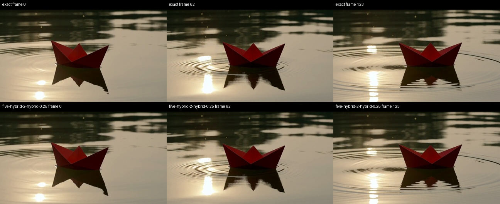

# H3 INT8 SOL hybrid attention and Apple Silicon latent upscaler

M5 Ultra, 80 GPU cores, 256 GB unified memory, macOS 27, PyTorch 2.14.
Date: 2026-09-28. Tests use an isolated ComfyUI server and memory watchdogs.

## Optional hybrid attention: complete workflow

Same H3 INT8-convrot model, 864×480, 124 frames at 24 fps, 20 steps,
`res_multistep` / `simple`, seed 812764035, red-paper-boat prompt. The FP16
video VAE and FP32 audio VAE are unchanged. Cache reuse, token reduction,
and the earlier relaxed attention/VAE preset are disabled.

| Mode | Warm sampling | Sampling / step | Warm end to end |
|---|---:|---:|---:|
| Current exact optimized attention | 133.22 s | 6.66 s | 144.47 s |
| Conservative INT8 SOL, initial Morton schedule | 123.91 s | 6.20 s | 135.20 s |
| **Final INT8 SOL, linear schedule** | **122.77 s mean** | **6.14 s mean** | **134.00 s mean** |

The final mode saves **10.46 s end to end (7.2%)**, and **7.8% sampling time**,
using the measured means. Final end-to-end runs were **135.048 / 132.961 s**
(sampling 123.830 / 121.707 s). The first linear run had 2.10 s of extra time
in its unchanged dense prefix. The sparse window itself repeated at
**35.349 / 35.313 s**, versus **37.47 s** with Morton. A final Morton control
returned to **135.180 s** end to end. Full latents, decoded video and audio
are byte-identical between the two schedules. The original Morton hybrid
already saved **9.26 s end to end (6.4%)** and **7.0% sampling time**.
Exact end-to-end repeats: 144.650 / 144.283 s. Hybrid repeats: 135.242 /
135.162 s. First exact load/warmup: 153.023 s, excluded. The previously
published stock 2.14 baseline remains 236.75 s; it was not rerun here and
is not the control used for the new hybrid percentage.

Identical initial noise and conditioning were verified. Exact repeats match
byte for byte in latents, decoded video and decoded audio. Hybrid repeats
also match byte for byte within their own mode. **Hybrid does not match exact.**

Policy: BF16 external Q/K/V, INT8 selected-token QK/PV, FP32 running softmax
state, FP16 summary PV; sparse tau 0.25 in the 0.50–0.85 denoising window;
zero-based layers 0, 1, 33, 34 and 35 remain dense. There were 315 sparse
attention calls out of 1000, across 7 of 20 model evaluations. Routed-block
density was 44.9%. Text/conditioning/audio query rows, including boundary
blocks, use exact PyTorch attention. Their key blocks remain selected in video
attention, but video queries still see quantized keys/values. Changes can
propagate from video into audio through subsequent layers.

All allocation, layout conversion, pooling, quantization, routing, prefix
attention and final layout costs are included. There is no CPU route-density
readback inside an attention call. Temporary activation storage is local to
the call; requests exceeding the conservative 4 GiB scratch estimate fall
back to dense attention. Shape/device/kernel failures latch a dense fallback
for the rest of that sample and are logged.

## Quality and limitations

On the five-second boat comparison, video-latent relative L2 was **0.08198**,
decoded-frame RMSE **0.02439**, PSNR **32.26 dB**, and mean RGB changes were
about −0.0015 / −0.0015 / −0.0020 on the 0–1 scale. Audio-latent relative L2
was **0.03668**. These are differences from a reference, not quality scores.

The inspected start/middle/end frames retain framing, boat shape, overall
color and rightward trajectory. Water ripples, reflected highlights and fine
edges differ. The earlier 0.20–0.85 window changed the one-second composition
substantially and is not the recommended policy. Protecting the early steps
and keeping the prefix query rows exact reduced that drift markedly.

The one-second 864×480 geometry provides essentially **no speed gain**:
exact sampling 17.30 s versus conservative hybrid 17.32 s in the initial
screen. A minimum sequence length of **8192** is recommended; short clips were
forced through the kernel solely to examine errors. No blanket claim of
identical detail, motion, speech synchronization or perceptual quality is
made. This remains an **opt-in experimental appearance/speed tradeoff**.

The additional one-second prompts used seeds 431927 (stationary teacup,
fabric and steam) and 957130 (walking woman, face turn and camera movement).
With sparse routing forced on for calibration, frame PSNR was 28.53 / 24.73 dB
and video-latent relative L2 was 0.09842 / 0.21033. Sampled frames preserve the
scene and action, but cup contour/steam, background foliage, facial details
and motion alignment change. Short clips show no practical timing benefit;
the 8192-token recommendation keeps these short cases on exact attention.
The exact repeat after each approximate run remained byte-identical, so the
approximate route did not contaminate subsequent exact renders.

[Teacup detail comparison](artifacts/h3-sol-hybrid/quality-texture-2-hybrid-0.25-compare.jpg)
· [Motion/face comparison](artifacts/h3-sol-hybrid/quality-motion-2-hybrid-0.25-compare.jpg).
These contact sheets are visual spot checks, not a comprehensive temporal
or audio quality certification. Raw clips and tensor captures remain in the
local diagnostic directory.

## Operator screening and rejected paths

One saved real H3 attention activation: [1,56,15458,128] BF16. Six rotating
warm measurement rounds, including preparation and output conversions.
The synthetic protected prefix for this operator screen was 512 rows; full
workflows instead derive the real video boundary from H3 stream metadata.

| Complete operator | Median time | Relative L2 to exact |
|---|---:|---:|
| Exact PyTorch query-cache | 64.47 ms | 0 |
| Existing BF16 SOL, tau 0.5 | 59.74 ms | 0.08285 |
| CCV INT8 SOL, tau 0.5 | **32.90 ms** | 0.08283 |
| Linked MPS SIMD SOL, tau 0.5 | 123.39 ms | 0.08285 |
| Existing BF16 SOL, tau 1.0 | 44.19 ms | 0.12737 |
| CCV INT8 SOL, tau 1.0 | **23.49 ms** | 0.12730 |
| Linked MPS SIMD SOL, tau 1.0 | 89.38 ms | 0.12737 |
| CCV all-selected INT8, BF16 external tensors | 77.40 ms | 0.01542 |

The linked MPS wrapper's output allocation needed correction for our
non-contiguous input layout. Its shader writes contiguous BTHD, while
`empty_like(q)` may preserve different strides. The table uses the corrected
allocation. The initial uncorrected screen is discarded.

An all-BF16 adaptation of the CCV register kernel took **275.04 ms** at tau
0.5 and **670.38 ms** with all blocks selected. It is rejected. This rejects
that concrete implementation, not all possible future BF16 kernels. Dense
INT8 was also slower than our exact query-cache, so it is not installed as
a replacement for dense attention.

No Morton *token permutation* is enabled. Workgroup scheduling does not
reorder model tokens or alter their RoPE correspondence. A subsequent linear
workgroup schedule measured **32.02 ms** against **40.43 ms** for Morton at
tau 0.25 with exact prefix handling, with byte-identical operator output;
the complete-workflow comparison at the top confirms it and linear is the
installed INT8 default. The private Morton option remains available for
regression comparison; it does not add a new quality mode.
The production module matches the diagnostic INT8 implementation byte for
byte at ragged 137-, 2968- and 15458-token shapes. Protected query prefixes
and the all-protected case match native SDPA bytes.

## Enabling it

Use **MiniMax H3 Acceleration** with:

- Cache disabled; token reduction off for the measured configuration.
- Sparse Attention on, Sparse Mode `corrected`, Sparse Kernel `int8`.
- Tau **0.25**, start **0.50**, end **0.85**.
- Dense Leading Blocks **2**, Protected Dense Layers **0,1,33,34,35**.
- Minimum Sequence Tokens **8192**.

The new fields are appended to preserve existing saved widget positions.
Old workflows retain their BF16 sparse backend and existing settings.
Turning sparse attention off restores the exact attention route, provided
other approximation options are also off. This is separate from the older
`ASFP8_MINIMAX_RELAXED` preset. The INT8 kernel requires an M5 and
`torch.mps.compile_shader`; other Apple Silicon generations retain the
existing BF16 and exact routes.

An API workflow is in `workflows/h3_sol_hybrid.api.json`.

## Latent upscaler

The new **H3 Latent Upscale · Apple Silicon** node uses the learned upstream
network, supports `mps` / CPU and FP16 / BF16 / FP32, and preserves H3's audio
and latent metadata. See [setup and memory behavior](../docs/h3-latent-upscaler.md).
The real checkpoint tested is `minimax_h3_latent_upscaler_3d_conv_v1_fp16.safetensors`.

### Real checkpoint timings and precision

Same saved one-second latent [1,24,7,30,54], 2× spatial upscale to
[1,24,7,60,108], equivalent to **864×480 → 1728×960**. Complete node timing
includes the typed model copy, GPU allocation, normalization, inference,
CPU output and GPU cleanup; CPU checkpoint is cached. Two warm repeats per
precision, first invocation excluded.

| Compute precision | Warm node mean | Latent relative L2 vs FP32 compute | Decoded-frame PSNR vs FP32 compute |
|---|---:|---:|---:|
| **FP16** | **0.425 s** | 0.001134 | 63.93 dB |
| BF16 | 0.443 s | 0.009328 | 49.79 dB |
| FP32 | 1.691 s | reference | reference |

All three tests load the **same FP16 checkpoint**, then select compute dtype.
These are not separate benchmarks of downloaded BF16/FP32 weight files.
FP16 offers the best measured speed and closest result to FP32; BF16 costs
similar time but introduces more rounding here. FP32 costs approximately
4× as much and does not restore precision already removed from FP16 weights.
All tensors were finite. Decoded FP16/FP32 comparison frames look very close;
metrics alone do not establish universal perceptual equivalence.

The real ComfyUI graph also completed upscaling, video/audio decode and file
export: **5.414 s FP16**, **5.405 s BF16**, **6.717 s FP32** (one warm graph run
each, excluding sampling). The FP16 upscaler itself took 0.495 s in that graph.
FP16 repeat upscaled latents and decoded frames are byte-identical. Audio is
unchanged across every precision. This upscaler does not modify or resample
sound.

Five-second input [1,24,37,30,54], same 2× scale, FP16:

| Temporal mode | Warm complete upscaler | Matches upstream with same settings |
|---|---:|---|
| Full context (`temporal_chunk=0`) | **1.851 s** | byte-identical |
| Upstream chunk length 32 | 3.023 s | byte-identical |

The full-context mode is recommended for this tested size on the Ultra.
Chunked versus full output has relative L2 0.03991: temporal chunking changes
normalization/context and is not an exact memory optimization. The one-second
full-context result also matches the upstream network byte for byte. These
parity tests change upstream's device selection to MPS and retain its actual
network arithmetic; they do not compare MPS with CUDA.

The validation process's sampled Metal driver-memory peak was **3.09 GiB**,
with **3.80 GiB** process RSS. The precision comparison process peaked at
**2.10 GiB** sampled driver memory. Sampling is not a guaranteed instantaneous
peak, and these separate-process figures exclude a resident diffusion model.
The node's admission checks, per-block command completion and bounded CPU
cache remain in place for larger requests. A five-second 2× VAE decode was
not timed here; the five-second numbers above are the upscaler alone.

An API example is in `workflows/h3_latent_upscale.api.json`. It uses the same
one-second source workflow and outputs 1728×960; it does not insert a second
high-resolution diffusion pass.

### Reproducibility and tests

[Machine-readable records](data/m5-ultra-h3-sol-hybrid.json) include per-run
hashes, timings, kernel screens, numerical errors and upstream parity checks.
The Python tests completed **103 passes**: 102 in the main MPS run, plus
the initially skipped real-ComfyUI dispatch test rerun successfully with the
install on Python’s import path. The frontend/migration suite completed
**7 passed**. Additional integration checks cover model listing, real ComfyUI node dispatch,
nested audio preservation, decoded frames and oversized-job refusal.

## Sources

- [Draw Things H3](https://github.com/drawthingsai/draw-things-community/blob/af27d5c2e73b9449c261c48e34e6c9c447fcd1a6/Libraries/SwiftDiffusion/Sources/Models/MiniMaxH3.swift)
- [CCV INT8 SOL kernel](https://github.com/liuliu/ccv/blob/6a611be1aab6470ae279115ae4eaf7e01bc87135/lib/nnc/mfa/kernels/NAInt8SolAttentionKernel.cpp), BSD-3-Clause; notice bundled in `third_party/ccv-BSD-3-Clause.txt`.
- [Compared MPS SOL implementation](https://github.com/yshenaw/ComfyUI-SolAttn-MPS/tree/45071126b0c1ee30b0e6b7103fa9d70924828ba5)
- [Learned H3 upscaler](https://github.com/LBH-123-AI/Comfyui_Minimax_h3_latent_Upscaler/tree/40316cf008b2fd8663263270669eb4da23f89d2c), MIT; notice bundled in `third_party/h3-latent-upscaler-MIT.txt`.
