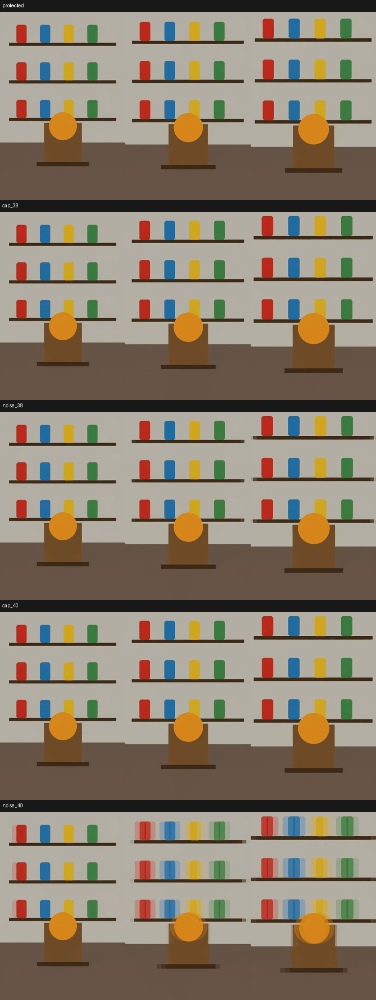
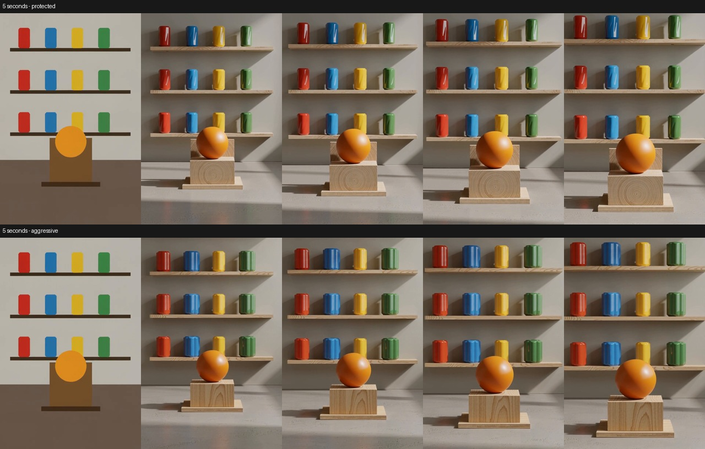

# H3 Fast protected and adaptive Fast aggressive

October 11, 2026 · M5 Ultra 80 GPU cores, 256 GB · PyTorch 2.14.1.

The corrected Fast recipe is now **Fast protected**. **Fast aggressive** is a
separate opt-in recipe using deeper token reduction for a bounded early phase.
Old Simple/API workflows selecting `Fast · experimental` resolve to Protected;
no old workflow is silently switched to Aggressive. Tokens remain Off by default.

## Policy

Both average adjacent horizontal target-video tokens after block 3 and restore
original within-pair detail plus the reduced stream's update. Neither changes
the reducer's arithmetic or the restoration implementation.

- Protected: restore before block **33** for the first ten model evaluations,
  then before **30**, preserving the corrected existing recipe.
- Aggressive: restore before **40** for the first
  **min(10, floor(sampler steps / 2))** steps, then before **30**.
- Thus 4/8/10/20/40-step schedules use 2/4/5/10/10 aggressive steps.
- Step selection derives boundaries from the actual supplied sigmas. Repeated
  CFG calls or skipped model evaluations do not prolong the aggressive phase.
  At one step, only block-30 restoration is used. Partial-denoise schedules use
  their actual length. Invalid nonmonotonic schedules are rejected explicitly.
- Existing advanced controls keep their evaluation-count policy. A new capped
  policy and early-step fraction allow manual tuning; the early-evaluation
  setting becomes a step cap in that policy.

These are optional approximations, not exact inference or guaranteed quality.
Blocks are layers within each model evaluation, not denoising steps. More
sampling steps do not change the model's 50-layer depth.

## Matched setup

768×1152 I2V, `res_multistep` / `simple`, same noise within each comparison,
INT8 ConvRot H3, FP16 video VAE, FP32 audio VAE. DMAD four-step LoRA strength 0.9
plus Turbo v4 strength 0.1, using the same chain as the artifact reproduction.
Cache and sparse acceleration Off, relaxed kernels Off, optimized PyTorch
attention. Short clips: 22 frames; longer confirmation: 124 frames at 24 fps.

Two diagnostic inputs: a procedural shelf with four colored containers on each
of three shelves, and a previously generated woman walking in a garden. No
private input image or original clip was read. Geometric seed 1; portrait seed
93742. The portrait prompt asks for a smooth following camera and coherent face,
coat seams, paving and shrubs. The geometric prompt asks for a smooth camera
move while retaining the shelf objects.

One isolated process warmed the models before serial policy screening; a fresh
isolated process then validated the actual production presets. Sampling timing
includes the model wrappers, allocation and token restoration. End-to-end includes
decoding and video saving. Loading/conditioning differences are identified below;
these are not stock-versus-optimized measurements. The 4/8/20/40-step sweeps have
one measured run per preset; the 10-step portrait Aggressive run was repeated.
The 20/40-step runs exercise scheduling; they do not establish that these Turbo
LoRAs are best used at those step counts.

## Policy screening: ten-step geometric clip

| Policy | Early / later steps | Sampling | End-to-end | Visual finding |
|---|---:|---:|---:|---|
| Protected, block 33 then 30 | 10 / 0 | 19.720 s | 22.416 s | No gross repeated outlines |
| Capped half, block 38 then 30 | 5 / 5 | 19.411 s | 22.081 s | No gross repeated outlines |
| Sigma ≥0.7, block 38 then 30 | 9 / 1 | 18.642 s | 21.252 s | Clean in this fixture only; not qualified further |
| **Capped half, block 40 then 30** | **5 / 5** | **19.018 s** | **21.676 s** | **Selected for further validation** |
| Sigma ≥0.7, block 40 then 30 | 9 / 1 | 18.138 s | 20.781 s | Repeated outlines/bands return; rejected |

The shifted ten-step schedule remains at or above 0.7 for nine steps:
`1, .99083, .97959, .96552, .94737, .92308, .88889, .83721, .75, .57143, 0`.
This tested noise threshold is therefore almost an all-step block-40 policy.
That rejects this specific rule, not every possible noise-based policy. The
block-38 noise variant remains a research candidate; it has only one fixture
and no multi-step or full-clip validation. The capped-half policy was chosen for
predictable exposure across step counts.

## Production preset validation

| Portrait steps | Protected sampling | Aggressive sampling | Sampling time reduction | Protected E2E | Aggressive E2E |
|---|---:|---:|---:|---:|---:|
| 4 | 7.883 s | 7.777 s | 1.3% | 14.794 s* | 10.525 s |
| 8 | 15.678 s | 15.222 s | 2.9% | 18.360 s | 17.938 s |
| 10 | 19.477 s | 19.165 / 19.061 s | 1.6–2.1% | 22.187 s | 21.863 / 21.805 s |
| 20 | 40.022 s | 38.092 s | 4.8% | 42.712 s | 40.817 s |
| 40 | 79.665 s | 78.276 s | 1.7% | 82.358 s | 80.952 s |

*The first portrait run includes fresh input/text conditioning; do not attribute
its E2E difference to token reduction. Other rows reuse that conditioning.
The incremental gain over Protected is modest. At 40 steps the ten-step cap
naturally limits the percentage gain.

The short portrait comparisons show no return of the conspicuous doubled-face
or horizontal-banding failure. Pose, expression, jacket folds and background
placement still differ; the presets are not visually identical. Three sampled
frames per clip are provided, not a universal temporal-stability certification:
[4 steps](artifacts/h3-token-dynamic/portrait-4.jpg),
[8 steps](artifacts/h3-token-dynamic/portrait-8.jpg),
[10 steps](artifacts/h3-token-dynamic/portrait-10.jpg),
[20 steps](artifacts/h3-token-dynamic/portrait-20.jpg),
[40 steps](artifacts/h3-token-dynamic/portrait-40.jpg).

## Five-second confirmation

| 124 frames, 10 steps | Sampling | E2E |
|---|---:|---:|
| Fast protected | 147.813 s | 169.302 s* |
| Fast aggressive | 144.459 s | 161.770 s |

Sampling saves **3.354 s (2.3%)**. The first run includes fresh longer-sequence
conditioning, so the raw 7.532-second E2E difference overstates the preset's
benefit. Decode times are essentially unchanged (16.228 vs 16.264 seconds).
This is one full-length pair, not a repeated throughput qualification.

Both retain four colored containers per shelf instead of the former severe
object-duplication failure. However, Aggressive introduces conspicuous vertical
ridges/repeated edges on the containers and changes the sphere, pedestal and
camera framing. These are visible quality differences, despite the absence of
the earlier catastrophic banding. The longer test therefore **does not qualify
Aggressive as preserving quality**. It remains an explicitly experimental choice;
Protected is preferred for this fixture given the small incremental saving.

The isolated validation process peaked at 11.29 GiB RSS and 62.00 GiB Metal driver
allocation (distinct measurements of unified memory). Its guards required at
least 48 GiB available RAM, capped process RSS at 110 GiB, set MPS allocator limits,
and checked for activity on the user's ComfyUI queue. No guard was triggered.
The test server was stopped after completion; the user's server was not restarted.

## Reproducibility and compatibility

- Protected matches the previous corrected preset byte-for-byte for conditioning,
  noise, final latents, decoded frames and audio on both matching short fixtures
  and the 124-frame geometric clip.
- The repeated ten-step Aggressive portrait run produces identical latents,
  decoded frames and audio to itself. It does not match Protected or exact output.
- 527 targeted CPU tests and 19 frontend tests pass. Coverage includes repeated
  CFG calls, skipped cache evaluations, cap behavior at 1/4/6/8/10/20/40 steps,
  actual restoration boundary, clone isolation and missing-current-sigma fallback.
- Legacy Simple labels migrate in ordinary graphs and subgraphs; the API alias
  remains accepted. Linked preset values are checked at execution, when available.
- GPU tests use token reduction alone. The CPU scheduling checks do not certify
  quality when combining the new preset with cache, SOL or Veda.

[Raw timings, restoration counts and tensor hashes](data/m5-ultra-h3-token-dynamic.json).
The earlier [Fast artifact investigation](m5-ultra-h3-fast-token-fix.md) describes
why the former unrestricted block-40 recipe was replaced.
