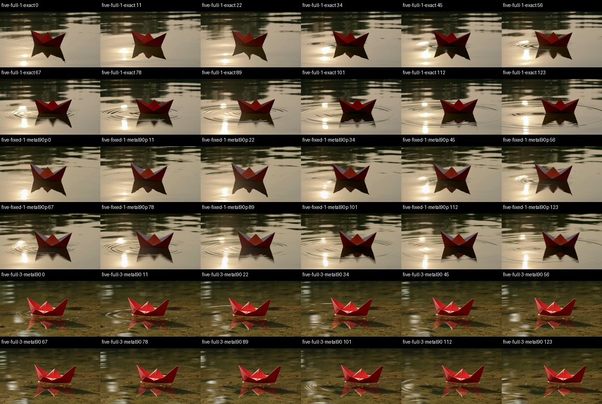
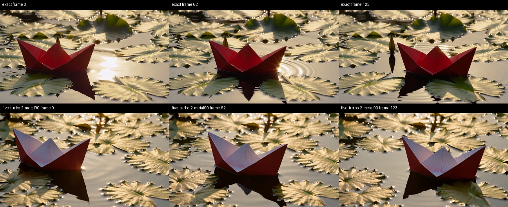
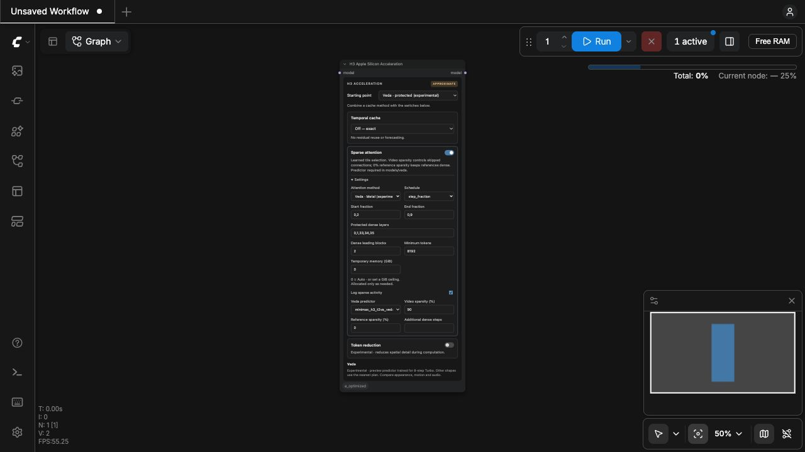

# H3 Veda learned sparse attention on M5 Ultra

October 5, 2026. M5 Ultra, 80 GPU cores, 256 GB; PyTorch 2.14.0; the existing exact Apple Silicon stack remains enabled. **Veda is an additional optional, non-bit-exact attention method. Existing defaults and accelerators are preserved.**

## Matched five-second comparison

864×480, 124 frames at 24 fps (5.17 seconds), 20 steps, `res_multistep` / `simple`, seed 812764035, no Turbo LoRA. H3 FL2VA pruned INT8 convrot DiT; INT8 convrot Qwen3-VL text encoder; FP16 video VAE; FP32 audio VAE. Older relaxed environment preset off. Reference/text encoding and models are warm. Complete timings include selection, layout conversion, allocation, sampling, audio/video decode and MP4 export. Cold startup/warmup runs are excluded.

| Mode | Sampling | Average per step | Complete clip | Less total time | Warm repeats |
|---|---:|---:|---:|---:|---:|
| Exact optimized | 133.41 s | 6.67 s | **144.72 s** | 0.0% | 3 |
| Existing INT8 SOL14 | 103.61 s | 5.18 s | **114.93 s** | 20.6% | 1 |
| Veda protected 90% | 111.00 s | 5.55 s | **122.42 s** | 15.4% | 2 |
| Veda full 90% | 97.15 s | 4.86 s | **108.46 s** | 25.1% | 2 |
| Veda full 80% (screen) | 103.11 s | 5.16 s | **114.45 s** | 20.9% | 1 |
| Veda full 90% + MotionCache | 73.01 s | 3.65 s | **84.37 s** | 41.7% | 2 |

Full Veda timings: 108.83 / 108.09 s; protected: 122.72 / 122.13 s. The hybrid repeated at 84.02 / 84.72 s, including one full run from the installed pack. MotionCache reused 5/20 model calls; the per-step column averages over requested steps, including reused ones. Existing SOL remains available. Selection and attention replace only the sparse spans; decode remains about 10.3 seconds in these runs.

Protected Veda: 90% generated-video sparsity, 0% reference sparsity; steps 0–3 and 18–19 and layers 0,1,33,34,35 use the exact dense route. Fast Veda: the same budgets on every step/layer. The SOL comparator uses the current INT8 corrected tau 1.3 recipe with the same protected span. A 90% tile sparsity setting is not a 90% reduction in total work; global rows/keys remain dense, and model matrix multiplies and decode remain.

These compare against the **current optimized exact** path. They are not additional stock PyTorch baselines or gains to multiply into the older README stock/optimized table.

## What changed

The upstream Apple implementation already supports MLX, but expanded K/V gather tensors and transfers dominated on this M5 Ultra. The first raw one-second test was slower than dense (8.97–10.78 s sampling versus 3.47–3.54 s). A raw five-second test hit the isolated process's 89.09 GiB allocator ceiling: 55.30 GiB PyTorch allocation plus 33.92 GiB other/MLX allocation. The process was stopped; this was not a machine-wide RAM OOM. We did not install that unbounded route.

The new Metal backend reads selected tile lists directly, without expanded K/V batches or a framework bridge. It retains FP32 attention accumulation. A fused pass copies Q/K/V into tile layouts and computes FP32 Q/K TripPool mean/min/max features. The learned predictor and top-k selector remain upstream's. Predictor projections are cached only for the current sampling run.

On five-second, two-step screens, bounded MLX took 29.87–30.09 s sampling, initial native Metal 12.07–12.13 s, and fused native Metal 9.97–10.06 s, against roughly 13.4 s exact. Native 32-key inner blocks beat the screened 64/128 alternatives. Warm head-group gather/statistics microbenchmarks improved from about 9–15 ms to 1–1.6 ms; complete sampler measurements above are the acceptance criterion.

The protected fallback initially bypassed our exact query cache. The adapter now re-enters the existing dense router. The earlier 126.68 s protected timing is superseded by the fresh-process repeated result above. Its output bytes matched the corrected protected route; this fix recovered performance rather than changing dense arithmetic.

## Numerical and visual comparison

The same saved initial noise is used for each matched comparison. Sampler video/audio latents, decoded frame tensors and decoded audio are saved. The optional mode is not presented as preserving quality merely because a tensor error is small.

| Mode | Video latent relative L2 | Decoded frame relative L2 | Frame PSNR vs exact | Temporal-difference error RMSE | Audio waveform relative L2 |
|---|---:|---:|---:|---:|---:|
| Protected 90% | 0.372 | 0.236 | 18.48 dB | 0.073 | 0.687 |
| Full 90% | 0.873 | 0.642 | 9.94 dB | 0.074 | 1.283 |
| Full 80% | 0.841 | 0.607 | 10.32 dB | 0.086 | 1.053 |
| Full 90% + MotionCache | 0.851 | 0.640 | 9.95 dB | 0.071 | 1.334 |

PSNR and temporal-difference error compare matched outputs; neither is a perceptual quality score. A change in motion/composition increases them even if an alternative output looks individually plausible.



[Generated side-by-side video: exact / protected / full / full+MotionCache](artifacts/h3-veda/veda-final-comparison.mp4) (muted comparison). Individual diagnostic outputs retain audio.

- **Protected 90%:** boat composition, gold water and rightward movement remain much closer to exact. Boat folding/shape and some reflection detail change. Its frame error is substantial; it is approximate.
- **All-step 90%:** brighter folded boat, darker green water and visible pond bottom; substantially different color/composition. Rightward boat movement is reduced. The generated comparison filmstrip does not show an obvious isolated frame break, but the altered motion and lighting are a meaningful change, not evidence of equivalent quality.
- **All-step 80%:** still changed water color/background and boat geometry, while being slower. Reducing sparsity did not restore this reference scene.
- **Full 90% + MotionCache:** retains the full-Veda scene shift; its boat/reflection details also differ. It is faster because five model evaluations are reused in this run, not a quality-preserving alternative.
- **Second short prompt/seed:** yellow silk flag over a meadow, seed 54871263, eight ordinary steps. Both full/protected modes changed fold detail and motion amplitude. At this sequence size sparse overhead was slower, so shipped presets leave sequences below 8192 tokens dense.

Audio waveform error is measured separately. Audio/global attention stays dense, but joint video/audio model processing still changes the audio output. We make no audio-perceptual-equivalence claim.

## Eight-step Turbo follow-up

Same geometry, prompt, seed, sampler/scheduler and VAEs; added the installed
`minimax_h3_fl2v_turbo_8step_v1.0_comfyui_bf16.safetensors` LoRA at strength 1
through the pack's H3 LoRA node (`fast_runtime`, Turbo validation), then used
eight steps. Warm exact averages **70.37 s end to end**; full Veda 90%
averages **55.88 s** (**20.6% less time**). Sampling averages
**59.16 → 44.51 s**. Two repeats each.

Background/lily-pad composition was closer than in the ordinary 20-step
comparison, but the boat geometry and fold color changed visibly (red to
pale inner folds). Rightward movement remains in the inspected frames. This
still does not qualify as the same generation/quality. Video latent relative
L2 **0.799**, frame relative L2 **0.476**, frame PSNR **11.74 dB**, decoded
audio waveform relative L2 **1.312**. These are comparisons to the Turbo
exact reference, not to the non-Turbo scene. Full Veda repeats and exact
restoration were byte-identical within their respective configurations.



[Generated Turbo side-by-side video](artifacts/h3-veda/veda-turbo-comparison.mp4).


## Compatibility, state and memory

Veda 0%/0% produced byte-identical sampler latents, decoded frames and audio against Exact in the complete short workflow. Exact was restored identically after Veda, Veda+MotionCache and Veda+protected Spectrum. Exact also repeated identically at five seconds after the full sparse/SOL sequence. Full Veda 90% repeats were byte-identical to each other on this configuration. This does not imply deterministic output on every backend/version.

Direct native self-tests cover BF16/FP16, 32/64/128 key blocks, empty/partial tiles, dense global rows/keys, reference spans and variable generated/reference tile budgets. Fused layout copies match upstream Q/K/V bytes; TripPool FP32 summation differs in order and is checked numerically. Ten native GPU tests pass. Coordinator/SOL/attachment/budget regression tests pass (85 CPU tests; 35 hardware-specific tests skipped in the sandbox); 14 frontend tests pass. Actual Nodes 2.0/classic controls were checked for method switching, independent cache/sparse switches and retained values.

Auto temporary-memory budgeting reuses the pack's RAM/headroom ceiling and additionally respects current PyTorch allocator headroom; head groups are chunked before their estimated buffers are allocated. MLX gathers use 128 MiB chunks and a 256 MiB cache limit restored at cleanup. Error fallback goes to dense attention for the remainder of that run, with the reason logged. Predictor/device caches reset at sampler cleanup. Model/input allocations are separate from the scratch ceiling.

Maximum **step-sampled Metal driver allocation: 63.32 GiB** across the accepted full-clip batches; maximum process RSS: **11.22 GiB**. The Metal value includes allocator caches and is not a precise active-tensor peak or a measurement of every transient kernel allocation. All native full-clip runs completed without an error/dense-fallback latch.

The benchmark process caps PyTorch at 0.4 of Metal's recommended working set, stops if child RSS exceeds 110 GiB or available system RAM falls below 48 GiB, and has a one-hour timeout. These are diagnostic safeguards, not changes to the live ComfyUI memory configuration. No SATA file or user clip was opened. Only authored text-to-video test inputs and our generated diagnostic tensors/outputs were used. Long clips, RefMod workflows and other resolutions were not benchmarked end to end; direct reference-span tests are kernel correctness checks rather than those workflow speed claims.

## Use and reproducibility

Select **Veda · protected (experimental)** or **Veda · fast (experimental)** in the existing **H3 Apple Silicon Acceleration** node. Fine-tune **Sparse attention → Settings**; the other two mechanism cards stay independent. The local predictor is stored on NVMe and linked into this install's default `models/veda` directory; normal-launch model discovery was verified separately from the diagnostic override. Existing MotionCache default is unchanged. Use **Exact · no approximation** to return to this node's exact route. [Control details](../docs/h3-acceleration.md#veda-learned-sparse-attention-optional).

Download the optional predictor explicitly:

```sh
python dev/setup_veda.py --models-dir /path/to/ComfyUI/models
```

The installer pins and verifies the checkpoint; it refuses to overwrite a different file. Native Metal needs no MLX package. To use the slower comparison backend, install the optional `veda-mlx` extra. Native execution is currently gated to M5 Ultra and verified PyTorch 2.14 MPP sources; unsupported configurations decline to dense.

Pinned upstream runtime: `fd59c7277ccc37ebf1a8f6823474b8c2ef2e33a0` (Veda-on-ComfyUI 0.2.0). HF checkpoint revision: `9a1fd3a41b4a754a7886e64e82edbddf599fd1bd`. Checkpoint SHA256: `2a8d8845c5342756a2781e8e69563940e4bb573c9a40ebb534915ff8fd76573a`. The 275,415,648-byte released preview filename says `600step`; its internal metadata records step 100. We did not retrain it. Runtime sources are MIT and copied unchanged with hashes/licenses; our adapter/backend are separate. The predictor uses the MiniMax Community License. [Attribution](../THIRD_PARTY_NOTICES.md).

The predictor's released geometry plans cover 1344×768, 768×1344, 768×768 and 1024×768 at 5/10/14 seconds with eight-step Turbo. Our 864×480 shape chooses the nearest upstream plan and is warned as outside the trained geometry set. This limits the quality conclusions and is a reason to keep both modes experimental.

[Machine-readable measurements](data/m5-ultra-h3-veda.json). [Ready-to-run protected API workflow](../workflows/h3_veda_protected.api.json). Raw logs, runtime/source hashes, API workflows, initial noise, latents, frames and generated comparisons are saved locally under `diagnostics/h3-veda`.

Authored boat prompt: “A cinematic close-up of a red paper boat floating on a shallow pond. The boat drifts gently to the right as a small ripple passes underneath. Warm morning sunlight sparkles on the water. A single continuous shot with a fixed camera. Audio: soft water lapping and distant birdsong.”

Authored flag prompt: “A wide shot of a yellow silk flag fluttering in a gentle breeze above a green meadow. Fine folds ripple across the fabric. Soft cloudy daylight, natural colors, fixed camera, continuous shot. Audio: gentle wind and rustling fabric.”


