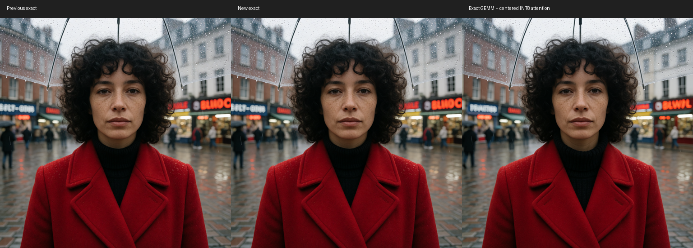
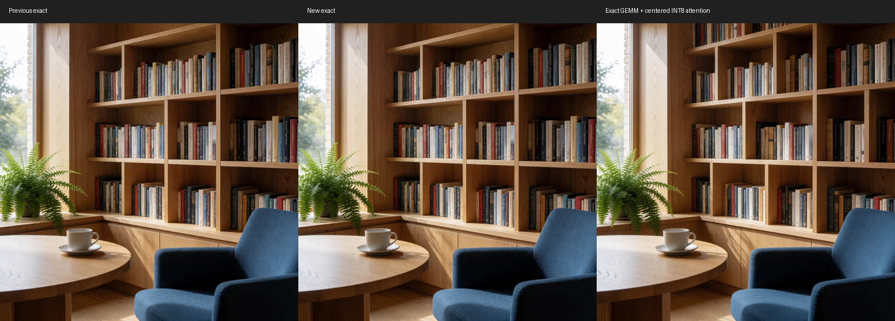

# Krea2 1024×1024 follow-up: Draw Things October kernels

Measured October 10, 2026 on M5 Ultra / 80 GPU cores / 256 GB / macOS 27.0,
PyTorch 2.14.1 (`5c488690…`), ComfyUI `v0.39.0-33-g1d2ea294`.
**Accepted: a narrow, exact INT8 GEMM output-tile schedule.** The existing
PyTorch attention, activation rotation/quantization, normalization/RoPE,
SwiGLU, VAE and sampler arithmetic remain intact.

## Matched 1MP results

| Configuration | Warm E2E | Sampling | Decision |
|---|---:|---:|---|
| Stock 2.14.1, pack absent | **15.63 s** | 15.28 s | Fresh baseline |
| Previous optimized pack | **6.24 s** | 5.98 s | Before this change |
| Accepted exact GEMM schedule | **6.13 s** | **5.88 s** | Default on for validated shapes |
| Accepted GEMM + centered-Hadamard INT8 attention prototype | **6.00 s** | 5.73 s | Research only; not promoted |

The accepted stack is **2.55× stock**, or **60.8% less total time**. This
follow-up saves approximately **0.11 s / 1.8% E2E**, with about **1.7% less
sampling time**. A separate four-render screening measured about 2% less
sampling time. These are small gains, not a new multi-fold improvement over
our previous pack.

The final matched process warms all three routes before averaging three
interleaved renders per route. Before: 6.259 / 6.276 / 6.199 s. Accepted:
6.102 / 6.112 / 6.183 s. Relaxed: 6.016 / 5.960 / 6.022 s. A separate production
run measured 6.106 / 6.229 / 6.109 s with the new default, preserving the old
latents and frames. Decode costs approximately 0.19–0.24 s; PNG export costs
about 0.03–0.04 s. Allocation, layouts, rotation and quantization remain inside
the sampling measurement.

**We did not reliably beat Draw Things' reported sub-six-second E2E timing.**
Our exact denoising itself is below six seconds; the complete workflow is
approximately 6.13 s. The relaxed prototype averages almost exactly six
seconds and straddles that boundary across repeats.

### Workflow and comparison scope

The canonical Krea2 workflow is resized from 1448-square to **1024-square**;
other settings are retained: **8 steps, Euler/simple, CFG 1, denoise 1**,
seed `535122089142682`, INT8 ConvRot checkpoint
`Krea2/krea2_turbo_int8_convrot.safetensors`, Qwen3-VL 4B FP8-scaled text
encoder, and `qwen_image_vae.safetensors` decoded in BF16. The product/nature
prompt is unchanged, with **25 text tokens / 4121 combined tokens**.

Primary measurements disable the workflow's optional LoKr, matching the
reported plain Draw Things setup more closely. The original LoKr
`Krea2/snofs_krea_v1_3D.safetensors`, strength **0.8**, separately measures
**6.25 → 6.18 s** E2E and **6.01 → 5.93 s** sampling. Its latents and frames
remain identical. Its complete verification render checks **1120 affected
GEMM outputs** against the previous schedule; verification time is excluded.

Warm E2E covers Comfy execution through decode and PNG export. Models and
unchanged conditioning are cached; each route's initial render/compilation is
excluded. Preview is off. We did not run the Draw Things application here or
obtain its exact prompt, checkpoint quantization or timing boundaries.
Its **8-bit S** and our **INT8 ConvRot** are different checkpoint/runtime
formats; same dimensions/steps alone do not establish identical arithmetic or
conditioning. The earlier README's 2MP rows remain separate measurements.

## What was implemented and kept

The new `int8_matmul_fused_cs_krea_1mp` entry uses a **64×128 output tile,
eight SIMD groups and an unswizzled grid**, compared with the existing
128×128 / sixteen-group grid. It exposes more independent work for K/V and
square projections. Each output still uses the same **INT32 accumulation,
Ultra K16/BK256 inner schedule, memory fences and BF16 rounding/rescale/bias
epilogue**.

Host selection is intentionally bounded to **M5 Ultra, BF16 columnwise-scale
GEMM, M=4096…4352, K=6144, N=1536 or 6144, without a split-tail dispatch**.
The wide MLP matrices, larger images, other hardware and other geometries keep
the preceding route. Set **`ASFP8_KREA2_GEMM_TILE=0`** before launch to restore
that route. No additional workflow node is required.

The code is installed in the **-Update** ComfyUI instance with the old file
backed up locally. The earlier ComfyUI instance is unchanged. No packages,
checkpoint precision, sampler settings or step counts were changed.

## Exact validation

- **20 native MPS tests** compare enabled/disabled schedules at aligned and
  unaligned row counts, both projection widths, with/without bias and at both
  range boundaries. Negative INT8 inputs and zero scales are included.
- **1120 actual intermediate GEMM byte checks** pass in the original full
  eight-step LoKr workflow.
- Complete sampler latents and decoded FP32 frame tensors preserve their
  SHA-256 hashes in repeated canonical renders, LoKr renders and two additional
  public prompt/seed fixtures: a rainy portrait and a detailed reading room.
- The existing INT8 linear and rowwise-quantization native references pass
  (**2 tests**); wrapper contracts pass (**13 tests**, integration cases
  excluded in that separate fixture run).

The legacy mock tests initially failed because Kitchen's lazy Torch/Dynamo
initialization encountered a mocked MPS availability function without its
`__wrapped__` attribute. Preloading Kitchen before the mocks fixes the test
setup. Native references additionally require ComfyUI on the import path and
MPS fallback set **before** Torch import. No runtime patch was added for those
fixture problems.

**Exactness is relative to the preceding optimized implementation.** The
pack's existing W8A8 activation quantization differs from stock W8A16; this
follow-up does not claim stock/optimized or ComfyUI/Draw Things byte equality.

## Experiments that did not make the default

| Candidate | Finding | Decision |
|---|---|---|
| Blanket 64-row GEMM selection | Narrow and square matrices improve, but the down-projection slows; full screening 6.29 s vs 6.24 s controls | Reject blanket policy |
| Select every isolated winning tile, including wide MLP / 3D down-projection | 6.14 s vs 6.12 s for the narrower policy; no material additional gain | Keep simpler policy |
| Upstream-style K32/BK512 in our 64-row GEMM | Byte checks pass, but captured projections are roughly 2.3–2.7× slower than our Ultra K16 schedule | Reject |
| 3D threadgroup dispatch / 128-row fence removal | Small or noisy operator gains; no convincing complete-workflow advantage over accepted selection | Reject |
| Exact PyTorch Q32 query tile, KV32 unchanged | Byte-identical; operator improves about 5%, but full workflow 6.29 s vs 6.23 s control | Reject |
| Q128 query tile | Byte-identical on captured input, but attention operator slower | Reject at screening |
| Plain INT8 QK/PV attention | Runs; operator first-block relative RMSE 17.18%, full render/content changes; ~6.10 s before exact GEMM addition | Not promoted |
| Centered Hadamard INT8 QK/PV attention | Better numerical accuracy; combined with accepted GEMM ~6.00 s, but only ~0.13 s extra E2E saving and changed generated details | Research only |
| Identical-input text-fusion cache | The entire repeated text-fusion work is only ~0.04 s per render; CPU comparison/synchronization erases the saving | Reject |

The first scalar-GEMM hook was a **no-op**: this unmerged checkpoint has
per-column scales and uses the columnwise entry instead. Zero candidate calls
were detected; that trial is excluded. The corrected trial records 448 actual
calls per two-step verification render. Six tile variants pass those byte
checks, and the selected policy is then checked through all eight steps.

## Latest attention adaptation and quality findings

We generated the latest CCV INT8 QK/PV forward kernels for Krea2's **48 query /
12 KV heads, D=128**, with head-major traversal, FP32 accumulators, 16-row Q
quantization, 64-row KV quantization, and chunked V means. Plain INT8 and
Hadamard + K centering are separate candidates. Mean/quantization allocations,
Q/K/V layout conversion, attention, output layout and gate costs are included.

We also implemented **direct BHSD input addressing in the mean and quantization
passes**, removing three BF16 layout copies while retaining the required INT8
layout. Direct BHSD output retains our existing gate/layout fusion. These
layout adaptations preserve the prototype's own output bytes, but quantized
attention still differs from exact PyTorch attention. First-use shader
compilation polluted the initial short screen; those timings are excluded.
After warming, both plain and centered variants provide only modest gains.

First captured block, centered-Hadamard versus exact: relative RMSE **5.04%**,
maximum absolute error **4.03125**, cosine **0.99874**. Those local errors
accumulate through denoising:

| Prompt / seed | Final latent relative RMSE | Decoded frame RMSE, 0…1 | Frame PSNR |
|---|---:|---:|---:|
| Product / canonical seed | 38.49% | 0.12837 | 17.83 dB |
| Portrait / 17 | 23.74% | 0.06895 | 23.23 dB |
| Reading room / 203 | 33.29% | 0.10836 | 19.30 dB |

All images are finite and coherent. The relaxed product scene changes the
bottle label, lighting and plants; the portrait changes signage, background
figures and some facial features; the reading room changes book arrangements,
fern details and furniture edges. No major broken geometry was visible in these
three fixtures. This is **not a quality-equivalence guarantee**, and the small
operator error alone would not justify such a claim. Exact outputs are
identical in all three fixtures.

The attention prototypes remain in
[the research artifacts](artifacts/krea2-oct2026/experiments/README.md), with
upstream attribution/license. They are not loaded by normal ComfyUI startup.
No approximate Krea2 mode is enabled by this change.

## Sources, reproducibility and safety

Draw Things' [October 8 release](https://drawthings.ai/downloads/) lists M5 Ultra
performance improvements and Metal quantized-attention accuracy improvements.
Relevant backend sources include
[shape/device-sensitive INT8 GEMM scheduling](https://github.com/liuliu/ccv/commit/5c7b0ec916cb5730ba78ff48ec530a0f99e1b15d),
[head-major attention](https://github.com/liuliu/ccv/commit/16ec14d7f70d20a0e3ac0c804967d5b9141fd836),
[FMA output rescaling](https://github.com/liuliu/ccv/commit/8d5a3cf557697221c2efe33b0352438171af90bc),
and [Hadamard/K-centering work](https://github.com/liuliu/ccv/commit/3af6541d36c8e302acd7b422d31f27e7e9fa5b3e).
The research generator uses CCV `4b8d569` (October 8), newer than Draw Things'
currently pinned CCV revision `c1baf131…`; this does not establish that every
experiment is in the shipping app.

[Recorded timings, settings, hashes, counters and numerical measurements](data/m5-ultra-krea2-oct2026.json).
Warm-up, verification and no-op trials are distinguished from performance
runs. One GPU job runs at a time in an isolated process; high/low MPS watermarks
are 0.4/0.3, with 110 GiB RSS / 48 GiB available-RAM watchdogs. RSS is not a
measurement of Metal allocations. No watchdog fired. Models are loaded only
from the NVMe model directory; no SATA files, private clips or confidential
images/workflows were opened. All assessment images use the documented public
prompts.
