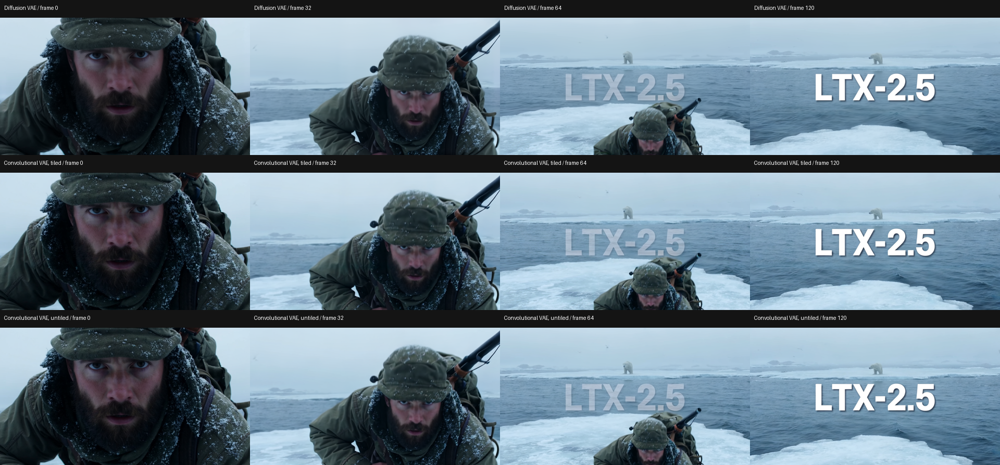

# LTX 2.5: further exact kernels and convolutional VAE

**M5 Ultra, 80 GPU cores / 256 GB, PyTorch 2.14.0, 2026-09-25.**
The original diffusion-VAE workflow now takes **46.38 s**, down
from **48.66 s** in the paired control. New kernels preserve every
saved native output byte. The optional convolutional VAE takes
**32.34 s tiled**, or **30.18 s untiled**; changing
the decoder or its tiling changes the frame tensors.

## Complete five-second workflow

Same original 1280×704 output, 121 frames / 24 fps, Arctic hunter prompt,
seeds 558811532553686 and 42, Euler ancestral with the saved manual sigmas,
8 steps followed by 2× latent upscale and 3 refinement steps. Audio generation,
decode and MP4 export are included. These are warm runs: model loading and
unchanged text encoding are cached. Cold/JIT and verification runs are excluded.

| Configuration | End to end | Both samplers | Video decode |
|---|---:|---:|---:|
| Stock 2.14, diffusion VAE (previous measured baseline) | 91.42 s | 43.81 s | 45.89 s |
| Previous native, diffusion VAE | 48.66 s | 25.19 s | 21.88 s |
| **New exact native, diffusion VAE** | 46.38 s | 25.20 s | 19.59 s |
| Stock 2.14, convolutional VAE / tiled | 51.71 s | 44.00 s | 5.94 s |
| Native, convolutional VAE / tiled | 32.34 s | 25.33 s | 5.41 s |
| Native, convolutional VAE / untiled | 30.18 s | 25.10 s | 3.53 s |

Exact-update control runs: [48.732, 48.655, 48.599]. New exact runs: [46.402, 46.337, 46.4].
Convolutional stock runs: [52.177, 51.461, 51.485]; native tiled: [32.087, 32.135, 32.787];
native untiled: [30.186, 30.187, 30.177]. The acceleration node is absent in stock.
The full stock/native stacks already differ numerically; exactness here means
the new kernels versus the otherwise unchanged native stack.

The actual output is 0.901 MP, 14.1% fewer pixels than 1024×1024. A separate
**1024×1024 / 121-frame / 8+3-step** convolutional-VAE run with original tiling
measures **37.82 s warm** ([37.84, 37.803]). This supplies a real
square-resolution measurement instead of extrapolating by pixel count. The
historical M5 Max's 86 s used LTX 2.3 and an earlier attention backend, so this
is still not a controlled Max-to-Ultra hardware comparison.

## Accepted exact changes

- **SwiGLU:** use a 128 KiB table of PyTorch's BF16 SiLU for every possible
  input bit pattern, then multiply by the up projection in the same kernel.
  The intermediate SiLU rounding remains. Projection matrix multiplies stay
  unchanged and continue through their normal modules.
- **Modulation:** fuse addition of one, multiplication and shift while
  retaining the separate BF16 rounding of every eager intermediate.
- **Neighborhood copies:** one kernel gathers Q/K/V tiles and another scatters
  their results. Preserve the original tile grouping, mask, key ordering and
  attention implementation. Only integer row offsets are cached, capped at
  32 MiB and 128 entries; the existing 128 MiB K/V-copy budget remains.

Repeated decoding of the same saved full-clip latent measured **22.00 → 20.19 s**
for elementwise fusions, then **20.21 → 19.70 s** with combined copies. The final
workflow includes allocation, mask generation, copies and all decoder costs.
Sampling is unchanged by the accepted additions.

All eight full native workflow runs reproduce the prior reference conditioning,
initial noises, both sampler outputs, upscaled latents, audio and final FP32
frames. Direct verification covers **32 deterministic decoder blocks and 8
diffusion blocks**. **62 targeted tests pass**, including all finite BF16 SiLU
inputs, modulation rounding, residual behavior, neighborhood edge shapes,
bounded row-map caching, unsupported-call fallbacks and existing attention.
The two changed implementation files are backed up and installed in the 2.14
custom node; a fresh installed-process one-second replay matches its reference.
No ComfyUI core files or original user workflows were changed.

The additions default on under the native preset on the validated hardware and
Torch build. Set each to `0` to disable independently:

```
ASFP8_LTX25_VAE_SWIGLU=0
ASFP8_LTX25_VAE_MODULATE=0
ASFP8_LTX25_VAE_LAYOUT=0
```

Setting all three to `0` restores this round's paired control. The existing
`ASFP8_LTX25_FAST=0` disables the earlier LTX 2.5 round as well. These new
decoder kernels do not apply to the convolutional architecture.

## Convolutional VAE and settings

`ltx-2.5-video-vae-conv-bf16.safetensors` loads through the normal **Load VAE**
node using its architecture metadata. It runs in BF16 and requires no new
compatibility patch. The standalone test harness was corrected to pass that
metadata, as ComfyUI already does.

For comparisons, decode the exact same saved sampler latents:

| Decoder / setting | Warm standalone five-second decode | Peak recorded MPS driver allocation in this decoder-only test |
|---|---:|---:|
| Convolutional, original 512 / overlap 64, temporal 64 / overlap 16 | 5.64 s | 12.32 GiB |
| Convolutional, regular **VAE Decode** (untiled) | 3.87 s | 21.47 GiB |

Untiled decoding avoids repeated overlapping work and changes boundary context;
it is faster here but is **not byte-identical to tiled decoding**. It also needs
more memory. Both settings reproduce identical bytes across their own repeated
runs. Keep the existing tiled node for larger jobs where memory is tighter.
These memory figures exclude the loaded sampler/text encoder and are not total
system-RAM measurements.

Optional copies of the original API workflow are saved in the shared workflows
folder as `video_ltx2_5_t2v_conv_tiled.json` and
`video_ltx2_5_t2v_conv_untiled.json`. They change the VAE and output prefix;
the second also replaces **VAE Decode (Tiled)** with **VAE Decode**. No sampler,
seed, prompt or step settings are changed.

Changing VAE weights is a model-output change, not an exact kernel optimization.
On this saved clip the convolutional outputs retain the scene and frame timing,
but fine texture, edges and color differ. Sampled frames show no gross corruption;
this one clip does not establish quality equivalence or rule out temporal issues.
The saved comparison videos allow direct motion assessment. Versus the diffusion
VAE, tiled convolutional output has MAE **0.01255**, RMSE **0.02072**, PSNR
**33.67 dB** on [0,1] FP32 frames. These error metrics are descriptive, not proof
of equal quality. Errors and RGB deltas for both convolutional settings against
the diffusion VAE are in the raw data. The original diffusion-VAE workflow
remains available unchanged.



## Rejected and neutral screens

| Candidate | Evidence / decision |
|---|---|
| Direct neighborhood reads with computed coordinates | Exact complete frames, but far slower; rejected. |
| Precomputed indices for direct reads | About 4.65 s versus 4.00 s for one-second decoding with materialized masks; rejected. |
| Procedural masks inside direct attention | Preserved bytes but added addressing/register work; about 8.6 s even with indexed reads, versus about 4 s; rejected. |
| Bounded dense-mask caches | 128/256/512 MiB screens did not show a practical repeated complete-decoder improvement; no mask cache installed. |
| Residual addition + following RMS normalization/modulation | Exact complete frames; full decode 19.735 s control versus 19.629 s candidate. Too small a benefit to justify the extra full activation buffer and block wrappers; not installed. |
| Sampling norm/modulation + rotation + INT8 quantization | First captured operations matched, but the ninth checked normalization site changed one INT8 byte. Normalized values and scales still matched. Full sampler latents and frames diverged, and warm one-second e2e was 13.07 s versus 12.94 s; rejected. |
| Alternative INT8 matrix schedule | Exact outputs on captured/repeated full-clip-size shapes, but the existing schedule was as fast or faster; retained. |
| Convolutional weight-packing reuse | Exact but effectively neutral at about 1.15 s for one-second decode; not installed. |
| Fused temporal input packing for convolution | Exact but about 1.15 s versus 1.14 s warmed; not installed. |

The earlier batch-budget sweep also remains neutral. These results do not prove
a hardware ceiling. Each rejected candidate remains in local diagnostics; none
is silently enabled or presented as an exact speed improvement.

## Reproduction

[Raw measurements, tensor hashes, model metadata, source hashes, memory guards,
test results and runtime settings](data/m5-ultra-ltx25-followup.json) accompany
this report. The [initial optimization report](m5-ultra-ltx25.md) preserves the
earlier stock and native measurements. All GPU experiments ran serially in
isolated processes/servers with memory limits; the user's normal server was not
restarted or patched in memory. Restart the 2.14 ComfyUI process to load the
installed update. Local comparison videos and the contact sheet are saved in
`ComfyUI-Shared/output/AppleSilicon-benchmarks/ltx25-2026-09-25-followup/`;
these videos contain the decoded frames without audio.
