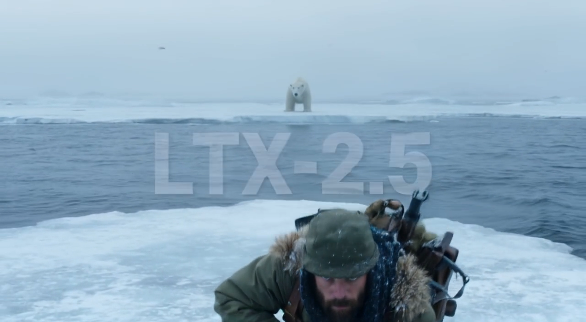
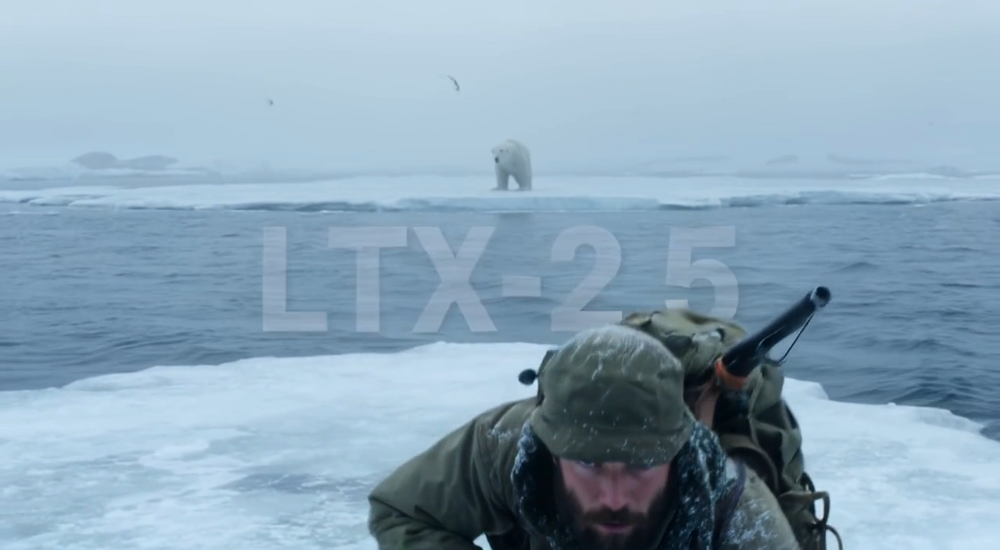

# LTX 2.5 text-to-video on M5 Ultra

This report preserves the initial results. The [follow-up](m5-ultra-ltx25-followup.md)
reduces the unchanged workflow to **46.38 s**, preserving its native output bytes,
and compares the optional convolutional VAE on the same saved latents.

**The unchanged five-second workflow averages 91.42 s stock → 48.84 s optimized.**

Measured 2026-09-25 on M5 Ultra, 80 GPU cores / 256 GB, macOS 27.0
(26A428), PyTorch 2.14.0 (`08187d9e0fba026dc8217405802ab5381dc88d90`),
ComfyUI `b33e2b55cae074eca5aec96283cceac19aa249ba`, Comfy Kitchen 0.2.35.

## Full five-second results

| Configuration | Warm end to end | Both sampling passes | Video decode |
|---|---:|---:|---:|
| Stock 2.14; acceleration node absent | 91.422 s | 43.807 s | 45.894 s |
| Previous native stack, paired control | 74.521 s | 27.253 s | 45.688 s |
| **New exact LTX optimizations** | 48.836 s | 25.357 s | 21.871 s |

Stock measured **91.340 / 91.408 / 91.519 s**, after two discarded warmups.
Native measurements discarded a cold control and an instrumented verification
run, then alternated/paired three measurements per route in one process.
Controls: **74.461 / 74.465 / 74.637 s**. Optimized:
**48.834 / 48.863 / 48.811 s**. The full native stack uses **46.6% less time
than stock**; this round saves a further **25.685 s / 34.5%** against the
previous native stack. Video decoding is just over twice as fast.

All eight full native runs reproduce the same conditioning, initial noise,
both sampler outputs, upscaled latents, decoded audio and final frame tensors.
The verification warmup additionally compares **2 full audio/video transformer
blocks, 32 deterministic VAE blocks and 8 diffusion VAE blocks** directly,
using cloned inputs and temporarily restoring the previous path. All match
byte for byte. Its extra comparisons are excluded from performance averages.
The three normal optimized timings include allocation, conversion, tiling,
quantization and MP4 export. Model loading and unchanged text encoding are
cached. Server startup/JIT is excluded in both configurations.

**52 targeted tests pass**, covering captured-style and random Q/K rotations,
VAE in-place normalization, boundary masks, batched neighborhood attention,
ragged long sampling attention, output strides, fallbacks and the existing
H3/Krea/Qwen query-cache cases. The final installed copy is checked in a fresh
isolated server, including original public keyword arguments and CPU fallback.
No ComfyUI core files were edited; the user's normal server is untouched.

## Frozen workflow

The user's `video_ltx2_5_t2v.json`: five seconds, 24 fps, 121 frames,
8 Euler ancestral steps, 2× spatial latent upscale, 3 refinement steps.
Seeds 558811532553686 and 42. Original Arctic hunter / polar bear prompt,
CFG 1 for video and audio, prompt expansion disabled. The full workflow
includes audio generation and decoding, tiled video VAE decode and MP4 export.

Resolution selector: 16:9, 0.9 MP, multiple 32. Its 1280×736 selection is
halved before the empty latent's stride-32 flooring. Actual first-pass output
is 640×352, and final decoded frames are **1280×704**. No settings were changed
to correct or conceal that discrepancy.

- DiT: `LTX-2/ltx-2.5-22b-distilled-transformer-comfy-int8-convrot.safetensors`.
- TE: `gemma4-12b-with-proj-ltx-2.5-comfy-int8-convrot.safetensors`.
- Video VAE: `ltx-2.5-video-vae-bf16.safetensors`.
- Audio VAE: `ltx-2.5-audio-vae-bf16.safetensors` (ComfyUI computes in FP32).
- Upscaler: `ltx-2.5-latent-spatial-upscaler-x2-bf16-1.0.safetensors`.

Only duration changes for the one-second screen (25 frames). Both samplers
rerun every repetition. Warm timings exclude cached text encoding and model
loading; both cold and warm runs are retained separately. Allocation,
quantization, layout changes, tiled decode and export remain inside timing.
An isolated server uses the same PyTorch 2.14 environment and ComfyUI core.
Stock imports no acceleration node; native uses ASFP8_NATIVE=1 with PyTorch
attention and relaxed MiniMax routes disabled. Fast math stays off.

## Accepted candidates and exactness contract

All additions preserve the previous native stack's intermediate rounding and
outputs. They do not assert byte equivalence between stock and the complete
native stack, which already changes quantized compute and text-encoder placement.

- **Current sampling RoPE API:** ComfyUI now passes `(rotation_matrix,
  split_mode)` and has a joint Q/K entry point. The earlier LTX patch expected
  three entries and never fused these calls. The new kernel reads the current
  rotation layout directly, retains the BF16 diagonal-product store before
  `addcmul`, and fuses both Q/K into one dispatch. All-head Q/K RMSNorm is
  unchanged; a per-head RMSNorm would compute different results here.
- **Sampling attention:** extend the hash-checked PyTorch query-load cache to
  long BF16 32-head / D128 self-attention. Write directly into sequence-first
  output storage. Preserve tile dimensions, matrix operations, softmax and
  reduction order. Short sequences keep stock attention.
- **Video VAE Q/K:** fuse per-head D64 RMSNorm, interleaved RoPE and the in-place
  store. Preserve FP32 normalization accumulation and its BF16 output rounding.
- **Neighborhood masks:** generate the same BF16 zero/minimum-finite mask in one
  Metal pass from integer geometry. This removes repeated GPU readbacks of
  axis maxima and temporary broadcast masks. Only bounded integer geometry
  parameters are cached (128 entries), never activations or decoded pixels.
- **Neighborhood scheduling:** batch independent tiles that share the same
  geometry. The eager implementation uses one tile per call on MPS; the new
  route uses a 128 MiB K/V-copy budget. Window boundaries, tile sizes, query/key
  order, masks and spatial/temporal tiling remain unchanged.
- **Masked decoder attention:** reuse the checked PyTorch D64 masked kernel
  with query-load hoisting and direct sequence-first output. This small final
  improvement is measured through complete decoding, including allocations.

These routes are scoped to the LTX decoder and guarded for the validated
Torch build, hardware, dtype/layout and inference mode. Unsupported calls use
the originals; shader initialization failure also falls back. No new model
precision, reduced sampling steps, sparse windows, prompt changes, frame
interpolation or different VAE tiling is used.

## Fixed-latent decoder experiments

Same saved 25-frame latent, original 512-pixel spatial tiles / overlap 64,
temporal tile 64 / overlap 16, BF16 video VAE. First-use timings are discarded.
Every variant below reproduced the same final FP32 frame tensor bytes.

| Decoder route | Warm complete decode |
|---|---:|
| Previous path | 8.65–8.70 s |
| Batched neighborhood tiles | 7.01 s |
| Fused Q/K RMSNorm–RoPE alone | 8.15 s |
| Batching + fused Q/K | 6.40–6.46 s |
| + exact single-pass masks | 4.15–4.19 s |
| + masked attention query cache | ~4.05 s |

The synchronized diagnostic profile found 8,044 SDPA calls and 1,148 mask
constructions in a one-second decode. Mask construction alone accounted for
2.59 s in that instrumented run. Profile synchronization inflates execution
time, so those figures identify costs rather than replace uninstrumented
complete-decoder measurements.

Captured sampling attention screening (including final layout conversion)
was 2.20–2.23 ms → 1.93–1.94 ms at 3,520 tokens. Repeating those captured
activations to screen the full 14,080-token shape gave 35.1–35.4 ms →
30.2–30.5 ms. The unchanged full workflow validates the real long activations.

Before the final masked-attention addition, the complete one-second workflow
measured **29.36 s stock → 18.31 s previous native → 13.40 s new native**.
All six paired native runs matched saved conditioning, both initial-noise
streams, upscaled latents, both full sampler outputs, decoded audio and frames.

## M5 Max comparison and remaining exact candidates

The historical README records **86 s** for LTX 2.3 at **1024×1024 / five
seconds** on M5 Max. The present output is **1280×704 = 901,120 pixels**,
versus **1,048,576 pixels** for that square output: **14.0625% fewer pixels**.
It is not a matched hardware comparison. The historical run used the earlier
custom `na` attention backend; the current workflow uses PyTorch 2.14 attention
and the LTX 2.5 neighborhood-attention diffusion VAE. Lightricks explicitly
describes that [diffusion decoder as costing more time and memory than the
convolutional option](https://github.com/Lightricks/LTX-2#full-model-list).
The old benchmark lacks a saved phase breakdown and full workflow provenance
here. Equal step counts and the 22B model family do not establish equal work.
A controlled comparison needs matching resolution, checkpoint, decoder,
workflow and attention implementation. Pixel-area scaling alone is inadequate.

The current full-run average comprises **25.357 s sampling, 21.871 s video
decode and 1.607 s other work**. It does not establish an optimization ceiling.

A further fixed-latent screen on 2026-09-25 swept the independent neighborhood
tile batch budget. Same saved 25-frame latent and original tiling; one warmup,
then three interleaved warm measurements per budget:

| K/V-copy budget | Complete decode, mean |
|---|---:|
| 64 MiB | 4.145 s |
| **128 MiB (current)** | **4.052 s** |
| 256 MiB | 4.029 s |
| 512 MiB | 4.039 s |

All runs reproduce the saved final FP32 frame bytes. The larger budgets differ
by less than 0.6%, with overlapping timing ranges; this does not establish a
practical gain. Production remains at 128 MiB, and the five-second benchmark
at the top remains unchanged.

A synchronized profile of the **current optimized** one-second decoder found
4,920 `torch.stack` calls (1.298 s), 1,404 attention calls (1.937 s), 1,148 mask
calls (0.309 s), and 1,794 linear calls (0.854 s). Stack includes RoPE matrix
construction and Q/K/V neighborhood gathering. SwiGLU blocks total 1.129 s,
including their linears and normalization. Instrumentation raised the full
decode to 6.396 s; these inclusive figures locate work and **are not additive
or forecasts of recoverable time**.

The strongest remaining exact candidates are direct neighborhood Q/K/V reads
and output writes to remove gather/scatter passes; implicit mask generation
inside attention while retaining identical mask values and arithmetic; and
fused SwiGLU/residual/modulation passes retaining BF16 store rounding. Sampling
also merits LTX-specific normalization-to-rotation/quantization fusion and
INT8 scheduling screens. Existing shared-input quantization caching is already
active. These are unaccepted candidates: each still requires operation/block
parity, complete output byte checks and repeatable complete-workflow gains.
Replacing this VAE with the faster convolutional checkpoint changes the
decoded output and is outside the bit-exact optimization contract.

[Follow-up measurements, source hashes and diagnostic script](data/m5-ultra-ltx25-exact-followup.json)
record this screen separately from the accepted benchmark.

## Controls

Enabled under the existing native preset on the validated M5 Ultra / Torch
2.14 build. `ASFP8_LTX25_FAST=0` restores the preceding native LTX behavior.
Individual switches (set to `0` to disable):

- `ASFP8_LTX25_ROPE`: sampling split-RoPE fusion.
- `ASFP8_LTX25_ATTN`: long sampling query cache / output layout.
- `ASFP8_LTX25_VAE`: all new decoder routes.
- `ASFP8_LTX25_VAE_ROPE`: decoder Q/K normalization–RoPE fusion.
- `ASFP8_LTX25_VAE_BATCH`: batching of identical neighborhood geometries.
- `ASFP8_LTX25_VAE_MASK`: single-pass exact mask construction.
- `ASFP8_LTX25_VAE_ATTN`: exact masked-attention query caching/layout.

Keep `PYTORCH_MPS_FAST_MATH` unset/0. The old native LTX norm/modulation path
remains independently controlled by `ASFP8_LTX_FAST`.

## Reproduction data and visual reference

[Raw timings, environment, source hashes, original API workflow, tensor hashes,
and experiments](data/m5-ultra-ltx25.json) accompany this report. The model
inventory records file sizes, modification times and safetensors **header**
hashes, not full-weight hashes. Full tensor captures remain local because they
are large. Exactness comparisons happen after timed execution.

Midpoint frames illustrate the existing stock/native differences. They are not
a claim that the complete native stack matches stock quality or pixels. The
new changes preserve the preceding native frame tensors exactly.

| Stock | Optimized |
|---|---|
|  |  |
