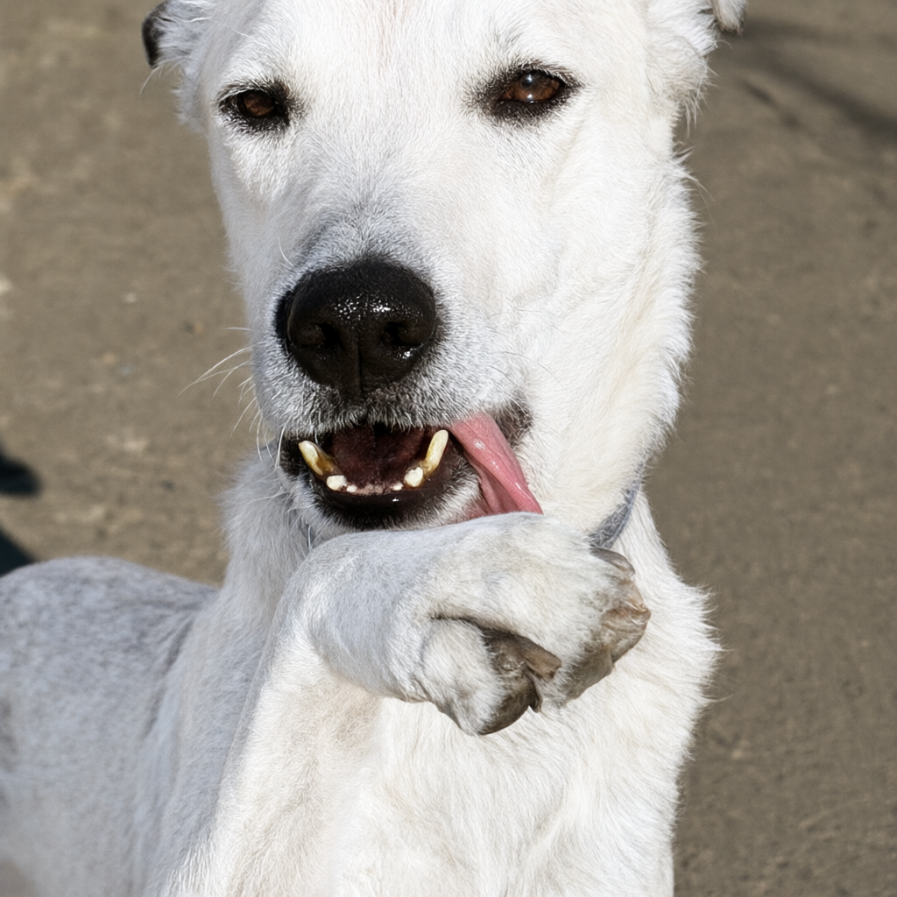
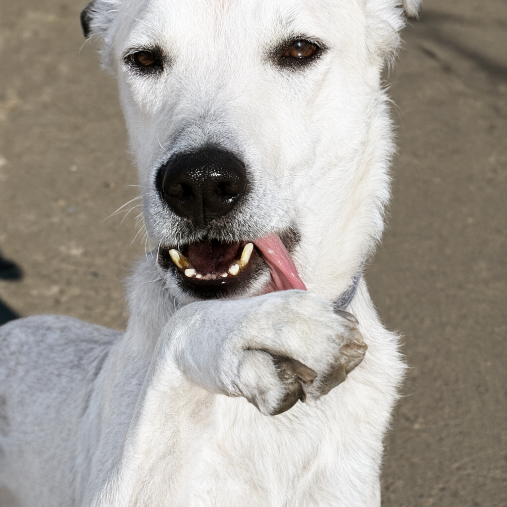

# Qwen-Image 2.1 image edit: exact kernels and attention alternatives

Measured 2026-09-25 on M5 Ultra, **80 GPU cores / 256 GB**, macOS 27.0
(26A428), PyTorch 2.14.0 (`08187d9e0fba026dc8217405802ab5381dc88d90`),
ComfyUI `b33e2b55cae074eca5aec96283cceac19aa249ba`, Comfy Kitchen 0.2.35.

## Frozen workflow and method

The user's saved `image_qwen_image_2_1_image_edit.json`:

- Input: `Qwen_image_2.1_00001.png`, 1024×1024; frozen copy and SHA-256 recorded.
- Prompt: `make the dog in <image1> have white fur`.
- Seed `88137371707251`, **40 steps**, Euler/simple, CFG 1, denoise 1.
- `TextEncodeQwenImage21` resolution 0; original image-to-image latent branch.
- DiT `qwen/qwen_image_2.1_int8_convrot.safetensors`.
- Text encoder `qwen3vl_8b_int8_convrot.safetensors`.
- VAE `qwen_image_2.1_vae_bf16.safetensors`.
- Original exact prefix cache, SaveImageAdvanced PNG export and ImageCompare.

The short screens change only step count (or explicitly recorded test prompt
and seed). Final measurements retain all 40 steps. Warm repetitions cache
model loading and unchanged image/text encoding. Separate fresh-input tests
force vision/text and VAE encoding again. Timers include allocations, layout
conversion, quantization and output conversion. Only one benchmark GPU job
runs at a time, on an isolated server; the user's normal server is untouched.

## Full 40-step results

| Configuration | Warm end to end | Sampling | VAE decode |
|---|---:|---:|---:|
| Stock 2.14, acceleration node absent | 50.767 s | 49.889 s | 0.602 s |
| Previous optimized stack, paired control | 24.742 s | 23.609 s | 0.850 s |
| **Installed exact improvements** | **23.079 s** | **22.358 s** | **0.441 s** |

Stock averaged 50.767 s (50.663–50.898 s), with the acceleration node
absent and two warmups discarded before three measured renders. The complete
optimized stack takes 54.5% less time than stock. This includes earlier native
kernels and fusions as well as the new exact changes.

For the native comparison, two full warmups were discarded, followed by three alternating measurements
per configuration in one process. Final end-to-end times were
23.087/23.068/23.082 s; controls were 24.537/24.809/24.881 s. The new work
saves **1.663 s / 6.7%** against the paired control. The earlier standalone
baseline averaged 24.563 s, so the improvement is also visible against that
separate measurement. All eight runs, including warmups, matched the original
reference's conditioning, initial noise, complete latents and decoded pixels.

The short integrated fresh-input check compared **64 attention outputs and
119 normalization outputs** byte for byte, covering both VAE encoding and
decoding. Full output hashes also matched when switching the new routes off
and on. Identical output bytes apply to these new changes relative to the
previous optimized stack; stock and native stacks are not byte-identical.

Two additional four-step edit cases also matched exactly, with input encoding
forced to run each time: a red-collar edit with seed 42 and a monochrome edit
with seed 901. Across the three integration cases, direct comparisons cover
**320 attention outputs and 357 VAE normalization outputs**, in addition to
complete conditioning, sampler latents and decoded frames.

The unchanged 25-step text-to-image workflow also passes the regression:
**13.152 s previously → 12.592 s now**, with identical conditioning, initial
noise, full latents and pixels. Its new warm runs were 12.739/12.529/12.509 s;
VAE decode averaged 0.472 s. Text-only attention is unchanged, so this
follow-up benefits from the shared exact VAE schedule.

## Accepted exact changes

**Attention:** retain PyTorch 2.14's MPP matrix operations, online softmax,
reduction order and tiles. Hoist query loads outside the key-tile loop and
write directly into the final sequence-first output layout, removing a copy.
The final route is restricted to BF16, batch 1, 32 heads, head dimension 128,
4096 queries and 8192–12288 keys. This covers the doubled context in the
1024² edit. Short text-only prefixes remain on ordinary PyTorch attention;
our earlier text-to-image test did not benefit from this specialization.

**VAE:** keep the existing serial channel reduction and all intermediate
BF16 rounding. Reduce spatial values handled by each thread from 32 to 1,
creating more GPU workgroups. This applies only inside the Qwen single-image
VAE's encode/decode calls (patch size 1, latent channels 64, temporal output
kernel 1), on the validated hardware/Torch build. Other Wan video routes
keep their existing schedule. Context restoration runs even on exceptions.

Identical-latent decoder screening, two measured repeats per schedule after
warmup:

| Spatial values per thread | Complete decode, mean |
|---|---:|
| 32, previous native | 0.78770 s |
| **1, accepted** | **0.34287 s** |
| 2 | 0.35105 s |
| 4 | 0.37345 s |
| 8 | 0.41966 s |
| 16 | 0.52121 s |

Every decoded tensor matched byte for byte. This is a complete VAE timing,
not an isolated normalization-kernel measurement.

## Sage-style / qlip-mlx experiment

Upstream [qlip-mlx](https://github.com/TheStageAI/qlip-mlx), commit
`142d28635aa65c57e6ee4168500f31033ee8a97a`, supplies a Metal Sage-style
kernel with INT8 Q/K multiplication, floating softmax and FP16 P×V. Its
published attention comparison is against MLX, not this PyTorch 2.14 stack.

A diagnostic PyTorch binding compiles those Metal kernels directly, avoiding
MLX transfers. The adaptation separates query and key lengths for Qwen's
cached reference prefix, replaces MLX function constants with compile-time
constants, and restores the caller's BF16 output dtype. Scratch allocation,
Q/K quantization, V conversion and output conversion are all timed. This is
a port of the upstream shader, **not an unmodified qlip-mlx package run**.
Three workgroup sizes (4, 8 and 16 simdgroups) were screened on captured real
attention inputs, alternating with PyTorch controls.

A separate process with `PYTORCH_MPS_FAST_MATH=1` still lost: its best target
attention measured 14.05 ms versus 6.19 ms for PyTorch. This compiler-option
control does not change the installed configuration.

| Actual attention shape | PyTorch 2.14 | Best tested Sage port |
|---|---:|---:|
| Q4096 / K4104, 32×128 heads | ~3.13 ms | ~5.59 ms |
| Q4096 / K8217, 32×128 heads | ~6.19 ms | ~14.27 ms |

The short complete-workflow check confirms the regression: two-step sampling
was **1.774/1.764 s** with PyTorch versus **2.286/2.359 s** with the Sage port.
It is therefore rejected and is not installed or enabled by any production
flag. No full 40-step quality-equivalence claim is made for this candidate.

Relative L2 error against FP32 attention was 0.00549 for the reference-image
call and 0.01182 for target-image attention; maximum absolute errors were
0.0787 and 0.2211. Sampler latents changed. These figures do not establish
visual-quality parity. The result rules out this tested design for this
workflow; it does not prove that every INT8 attention algorithm must be
slower on Apple Silicon.

## Comfy Kitchen attention and MiniMax H3

Installed and current upstream Comfy Kitchen 0.2.35 were inspected (upstream
commit `d16dfcf812d27b8b353b312f7ba7472928f79068`). Its
[backend matrix](https://github.com/Comfy-Org/comfy-kitchen#backend-capabilities-matrix)
lists `int8_attention` for CUDA and HIP, with no MPS implementation.
Runtime verification on this Mac returned:

- `int8_attention_is_available(torch.device('mps'))`: **False**.
- Calls using both Qwen's and H3's head geometry: `ValueError: q, k, and v
  must be on the same CUDA device`.

The current ComfyUI backend selector advertises this option on supported
NVIDIA/AMD devices. Forcing an unavailable option can fall back to PyTorch;
a workflow completing is not evidence that Kitchen attention executed.
Other Kitchen operations already used by ComfyUI can still run on MPS.

Qwen's unequal query/key lengths are supported by the API on supported
hardware, and H3 has integration for prequantized attention. **Neither has
an available Kitchen INT8 attention backend on this Mac.** Using it here
would require a new Metal implementation, then actual shape-specific
benchmarks and end-to-end quality checks. Its INT8 Q/K/V, UINT8 probability
and smoothing design also differs from the qlip port, so that experiment's
result does not determine a future Kitchen-style port's speed. Such a port
would be an optional non-bit-exact route, including for H3.

**114 targeted tests passed, with no skips.** Coverage includes the new
VAE schedule and asymmetric attention layouts, offsets/tails, opt-outs,
shared attention routing, and existing SDXL/Krea native paths.

## Reproducibility

The [raw results](data/m5-ultra-qwen21-edit.json) contain the frozen workflow,
input and checkpoint hashes, per-run timings and output hashes, runtime source
hashes, extra validation workflows, compiler control and rejected experiments.
Large reference tensors and scripts remain in `diagnostics/qwen21-edit` in the
workspace. The normal ComfyUI server was not restarted during testing.

| Stock 2.14 | Optimized |
|---|---|
|  |  |

Both perform the requested white-fur edit with similar composition. The
complete stock and native stacks differ in fine pixels; the new exact changes
produce the identical image as the previous native implementation.

## Remaining costs and controls

Profiling and repeated identical-input phase tests also covered vision/text
encoding, reference VAE encoding, MLP/projections, output save and comparison.
Before the new scheduling, warm reference VAE encoding was ~0.225 s; each
vision/text encoder call was ~1.45 s. The graph evaluates positive and negative
conditioning. Existing exact Qwen fusions and native INT8 matrix multiplies
remain active. We did not change conditioning semantics, cache policy, step
count or the workflow to manufacture a speedup.

With the native stack and PyTorch backend enabled, the two exact improvements
are on by default on the validated M5 Ultra / Torch 2.14 build:

- `ASFP8_QWEN21_ATTN=0`: disable the new edit-attention specialization.
- `ASFP8_QWEN21_VAE=0`: restore previous VAE normalization scheduling.
- `ASFP8_QWEN21_FAST=0`: disable these and the earlier exact Qwen fusions.
- `ASFP8_MPP_QCACHE=0`: disable query caching across all supported models.

The INT8 embedding compatibility repair remains independent. Restart ComfyUI
after updating the installed node. No ComfyUI core or model checkpoint is
modified. Rejected research code stays in `diagnostics/qwen21-edit` in the
workspace, outside the installed node.
