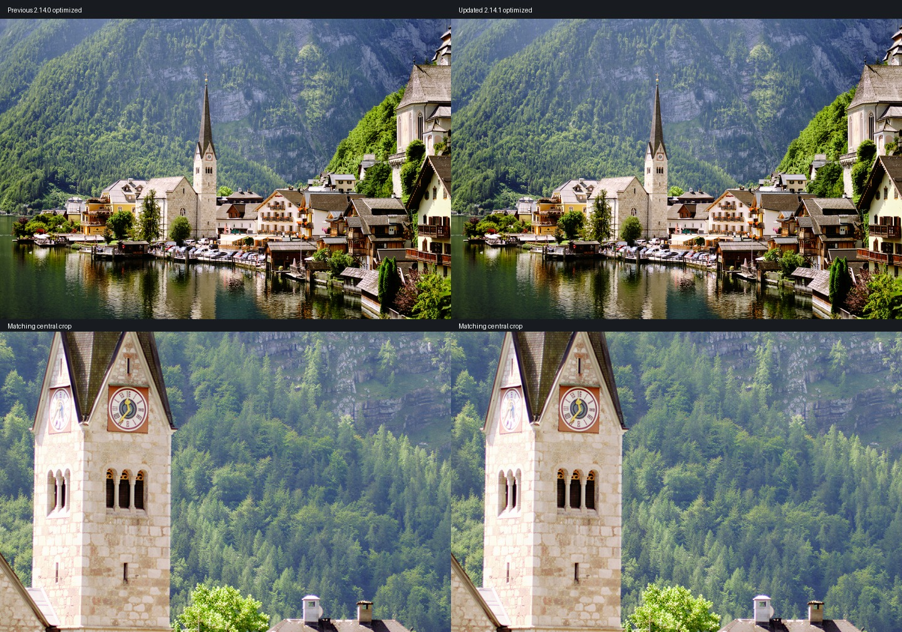
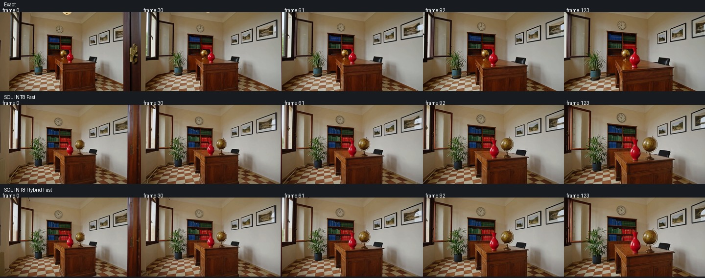
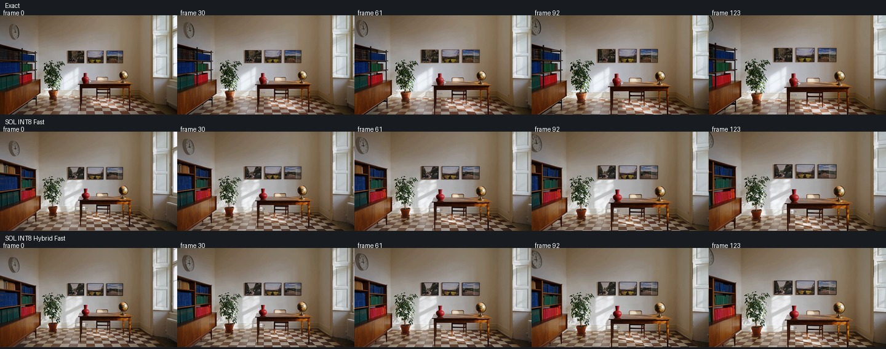

# M5 Ultra: PyTorch 2.14.1 regression and workflow retest

**Completed 2026-10-09.** Primary stock/optimized pairs and supplemental accelerator, audio, video-safety and auxiliary-model checks pass after the compatibility repairs below.

Measured on the M5 Ultra, 80 GPU cores, 256 GB unified memory, macOS 27.0. Only the `ComfyUI-AppleSilicon-2.14-Update` instance was changed. The earlier installation is preserved.

**Subsequent SeedVR VAE follow-up:** the new exact fusion reduces its fresh before/after full-image comparison from **47.44 to 45.15 s**. Bounded video scheduling reduces the same generated five-second fixture from **128.18 to 124.66 s**, with **33.58 GiB** peak Metal driver memory. Outputs remain byte-identical to the current optimized stack. The table below preserves the initial stack-retest measurements; see the [follow-up audit](m5-ultra-seedvr2-vae2141.md) for the latest SeedVR result.

## Runtime and measurement method

- Python 3.13.12; PyTorch 2.14.1, source revision `5c4886908584029761b579af026dcfb627c84070`; torchvision 0.29.1.
- ComfyUI commit `1d2ea2948d33dfda4d7cfe58c6d234968aa62cf8`, described by Git as `v0.39.0-33-g1d2ea294`, package version 0.39.0. This checkout is not the tagged v0.39.2 release.
- Frontend 1.55.16, PyAV 19.0.1. Models load exclusively from the NVMe model directory.
- Renders are serial, with MPS fast math disabled. Images exclude two warm-ups and average three measured renders; full video workflows exclude one warm-up and average two measured renders. Direct SeedVR and YuE checks exclude the first render.
- Workflow timings include sampling, decode and file export. Loading and unchanged conditioning are cached. YuE regenerates score/music tokens and conditioning each time. Tensor copying, hashing and numerical comparisons happen outside the timed workflow.
- Stock omits this custom pack. Qwen INT8 text encoding needs a minimal embedding compatibility shim. SeedVR stock retains scheduling-only memory protection to avoid intentionally reproducing the unsafe allocation pattern.
- Cache, token reduction, sparse attention and relaxed H3 kernels are off in the primary table. Those optional modes are reported separately.

No SATA files, confidential Qwen inputs or private user clips were opened. Qwen edit uses a freshly generated kitten reference, so its prior private-reference timing is contextual rather than matched. SeedVR video uses a newly generated H3 fixture, resized to 416×736 and looped to the requested frame count: the historical video path is missing. Old video timings are therefore contextual.

## Primary workflow timings

| Matched workflow | New stock | New optimized | Previous optimized | Less time vs new stock |
|---|---:|---:|---:|---:|
| SDXL, 896×1152 / 12 steps | 2.61 s | **2.40 s** | 2.42 s | 8.2% |
| Z-Image Turbo, 1024×1024 / 8 steps | 7.86 s | **3.44 s** | 3.44 s | 56.3% |
| Flux.2 Klein 9B, text-to-image / 1024×1024 / 4 steps | 5.61 s | **2.27 s** | 2.25 s | 59.6% |
| Flux.2 Klein 9B, image edit / 1024×1024 / 4 steps | 9.25 s | **4.64 s** | 4.66 s | 49.8% |
| Ideogram 4, 1024×1024 / 12 steps / dual-model CFG | 43.54 s | **18.21 s** | 18.23 s | 58.2% |
| Krea2 Turbo, 1448×1448 / 8 steps + LoKr | 27.45 s | **13.63 s** | 13.69 s | 50.4% |
| Krea2 Turbo, same workflow without LoKr | 27.54 s | **13.96 s** | 13.80 s | 49.3% |
| Qwen-Image 2.1, 1024×1024 / 25 steps | 28.94 s | **12.66 s** | 12.59 s | 56.3% |
| Qwen-Image 2.1 edit, generated reference / 1024×1024 / 40 steps | 50.47 s | **23.00 s** | Different reference | 54.4% |
| MiniMax H3, 864×480 / 124 frames / 20 steps | 236.97 s | **141.65 s** | 142.69 s | 40.2% |
| LTX 2.5, diffusion VAE / 1280×704 / 121 frames / 8+3 steps | 90.82 s | **46.16 s** | 46.38 s | 49.2% |
| LTX 2.5, convolutional VAE / same clip and original tiling | 50.98 s | **32.05 s** | 32.34 s | 37.1% |
| Wan 2.2 I2V 14B×2, 512×512 / 81 frames / 20 steps / CFG 3.5 | 421.16 s | **304.33 s** | 302.65 s | 27.7% |
| Wan 2.2 I2V 14B×2, same clip / 4-step LoRAs / CFG 1 | 46.14 s | **31.90 s** | 32.36 s | 30.9% |
| SeedVR2 7B INT8, 2400×1600 → 7200×4800 / 1 step | 66.29 s | **47.59 s** | 49.01 s | 28.2% |
| YuE2 3B INT8, controlled 8 s / 128 ABC tokens / 32 steps | 124.19 s | **5.78 s** | 5.60 s | 95.3% |

## Repairs accepted on the new stack

The previous explicit Torch 2.14.0 checks disabled validated kernels on 2.14.1. Supported wheels are now pinned by both version and actual source revision. Existing hardware, dtype, shape, layout and source guards remain, and unknown builds fall back. The expanded PyTorch Metal attention source hash is unchanged. This restores the Qwen, Flux, LTX, Ideogram, Wan and YuE exact fusion routes.

Qwen's current attention callback requires `AttentionTensorContainer` arguments. Its wrapper supplies those on the new core while retaining the earlier raw-tensor API. Tests cover both contracts, and restored current-stack fusions preserve the existing optimized output bytes.

SeedVR changed its decoder, residual-block memory arguments, window-index return structure and text-concatenation ordering. The bounded allocation and tile safeguards now follow these contracts. Its current matrix RoPE and AdaSingle normalization are supported by the native fusion wrappers: the AdaSingle `(scale - 1) + 1` BF16 rounding boundary is retained. Current image VAE residual fusion preserves the original in-place addition and is limited to disabled video-memory state. Source hashes, the reviewed Torch build and validated M5 Ultra hardware guard these modern fusion routes; unsupported combinations keep the original core implementation with memory safeguards.

The compatibility-only large SeedVR image run took **55.74 s**. Restoring these exact fusions reduced it to **47.59 s** (14.6% less time), with byte-identical encoded latents, sampled latents and decoded pixels. An installed-default smoke check confirms the accepted fusions are active. The stock counterpart took **66.29 s**. Sampled Metal driver peaks were **52.12 GiB stock** and **31.73 GiB optimized**.

YuE's source guard recognizes the reviewed current Llama implementation, with the same pinned-build gate. The full-song and Mothersuperior adapter workflows preserve all paired GPU token/tensor/waveform/FLAC bytes. Across stacks their encoded FLAC audio frames and PCM checksums are identical; only the exporter vendor comment changes from `Lavf62.12.102` to `Lavf63.1.102`.

## Output comparisons and their limits

SDXL, Z-Image, Krea with and without LoKr, Ideogram, canonical H3, both LTX VAE workflows and both ordinary/turbo Wan workflows preserve every captured tensor from their earlier accepted optimized runs, including sampler stages and decoded frames/audio where applicable.

Flux and SeedVR outputs change across the stack update even with the pack absent. Initial noise/conditioning are unchanged for Flux; the SeedVR input PNG bytes are unchanged. Therefore these changes cannot be attributed solely to restoring our fusions. Restored fusions preserve each model's **current optimized** output bytes. Flux inspection of the safe generated fixtures found the same composition with fine-detail changes; this is not a quality guarantee for arbitrary prompts. Flux text-to-image frame MAE was 0.0075854, PSNR 33.65 dB; its edit case was 0.00138205, 52.71 dB versus earlier optimized output.

The large SeedVR comparison retains the scene, architecture and colors, with small foliage/texture changes in the reviewed full image and central crop. Exported RGB pixel MAE is **0.003335**, RMSE **0.006042**, and maximum difference **0.3294** on a normalized 0–1 scale. A single image and these error values do not qualify arbitrary inputs.

The optimized pipeline includes its existing INT8 matrix routes. These checks do not assert that all optimized pipelines are byte-identical to stock. Optional sparse attention, token reduction, predictor/cache recipes and relaxed VAE modes remain approximate relative to exact optimized inference.

## YuE full-song and adapter GPU checks

| Workflow | GPU fusions off | Optimized | Previous optimized |
|---|---|---|---|
| Saved graph, 83.2 s song | 50.46 s | **34.12 s** | 33.48 s |
| Mothersuperior AR + real-audio v4, 20 s | 31.35 s | **21.94 s** | 21.18 s |

These rows compare matched GPU implementations, not a measured complete stock CPU song. The saved graph retains its 120 s maximum and ends naturally at 83.2 s. Both current pairs preserve token, conditioning, sampler, waveform and FLAC bytes. Earlier-stack tokens and waveform bytes match too. Encoded FLAC audio frames and PCM checksums are identical across stacks; the vendor comment changes from `Lavf62.12.102` to `Lavf63.1.102`.

## SeedVR bounded-memory checks

| Test | Warm E2E | Peak Metal driver | Repeatability |
|---|---|---|---|
| 7B INT8 video, 9 frames | 9.95 s | 18.50 GiB | identical |
| 7B INT8 video, 120 frames / 5 s | 128.57 s | 33.55 GiB | identical |
| 7B INT8 video, 240 frames / 10 s | 262.57 s | 46.15 GiB | identical |
| FP16, 320×213 → 960×638 | 0.90 s | 21.25 GiB | identical |

Video retains the saved 7B model and full context, with Split Latent off. Input is 416×736 and output 832×1472. The historical video is missing; this is a new generated fixture at the same dimensions, not a strict old/new input comparison. No memory watchdog tripped. The 10 s job sampled at least 125.48 GiB system-available memory. These measurements do not justify disabling safeguards for larger inputs.

## All H3 recipes: short compatibility screen

| Recipe | Warm E2E | Repeated tensor bytes |
|---|---|---|
| Exact optimized | 19.51 s | identical |
| MotionCache · protected | 17.40 s | identical |
| MotionCache · balanced | 15.81 s | identical |
| FirstBlockCache · protected | 14.99 s | identical |
| FirstBlockCache · fast | 11.49 s | identical |
| Spectrum · protected | 13.15 s | identical |
| Spectrum · fast draft | 11.46 s | identical |
| SOL INT8 · conservative | 19.06 s | identical |
| SOL INT8 · balanced | 18.40 s | identical |
| SOL INT8 · fast | 18.23 s | identical |
| SOL INT8 · top-k wide | 18.17 s | identical |
| SOL INT8 · top-k all-step draft | 17.88 s | identical |
| Dense INT8 · protected | 19.19 s | identical |
| Dense INT8 · full draft | 19.11 s | identical |
| SOL INT8 · hybrid fast | 18.37 s | identical |
| Veda Metal · protected | 24.74 s | identical |
| Veda Metal · fast draft | 27.89 s | identical |
| Protected · experimental | 18.51 s | identical |
| Balanced · experimental | 16.53 s | identical |
| Light · experimental | 17.31 s | identical |
| Fast · experimental | 14.58 s | identical |

864×480, 22 frames, 20 steps, two measured renders per recipe. Sparse minimum-sequence gating was explicitly lowered only for this short compatibility screen so its kernels were exercised; normal presets retain their threshold. Counters confirm accelerator activity. Protected steps/layers use their intended dense routes. All 21 recipes produce finite, repeatable output. Veda is slower than exact on this small clip. Timings here do not establish relative performance or quality at full length. Top-k Wide keeps its user-reported morphing warning; the previous quality caveats remain. Combined recipes are not newly quality-qualified by this individual-recipe screen.

## Combined H3 recipes: short compatibility screen

| Recipe | Warm E2E | Repeated tensor bytes |
|---|---|---|
| MotionCache Protected + SOL Fast | 18.48 s | identical |
| Spectrum Protected + SOL Hybrid Fast | 12.93 s | identical |
| FirstBlockCache Protected + SOL Balanced + Protected Tokens | 14.59 s | identical |

Same 22-frame screen with sparse minimum-sequence gating lowered to exercise the wrappers. All combinations are finite and repeatable. MotionCache + SOL skips **0/20** calls on this prompt: its threshold is not crossed, so it adds overhead rather than an additional gain. Spectrum saves 7/20 model calls; the triple recipe skips 245/1000 transformer blocks and reduces tokens in 9/20 evaluations. The combinations work, but gains are not additive and quality is not newly qualified by a one-second test. Normal short-clip presets retain their sparse sequence threshold.

## H3 attention camera scene: full-size checks

| Mode | 864×480 / 124 frames | 1344×768 / 124 frames |
|---|---|---|
| Exact optimized | 146.40 s | 606.72 s |
| SOL INT8 Fast | 114.26 s | 384.59 s |
| SOL INT8 Hybrid Fast | 113.79 s | 371.75 s |

The matched public camera push-in scene contains a desk, vase, globe, clock, books, three photographs, plant and checkerboard floor. Seed 812764035, euler/simple, 20 steps. Cache, token reduction and relaxed VAE are off. Approximate attention is compared with exact optimized inference, not vanilla.

Earlier averages were 143.20 / 587.48 s exact, 113.74 / 372.87 s SOL Fast and 113.04 / 365.41 s Hybrid at the two sizes. The large current exact reference is 3.3% slower in this batch; Fast is 3.1% slower and Hybrid 1.7% slower. This historical comparison does not isolate Torch from core changes or run conditions. All six current mode/size pairs preserve their earlier captured conditioning, noise, latents, audio and frame bytes. Counter logs confirm actual sparse/quantized activity. Reviewed contact sheets show stable scene geometry in the sampled frames, with the earlier composition/detail differences between modes retained.

## VAE routes and relaxed H3 kernels

| Route | 22-frame / 2-step E2E | Video decode only |
|---|---|---|
| FP16 exact | 3.74 s | 1.52 s |
| INT8 core weight-only compatibility | 4.59 s | 2.46 s |
| INT8 native W8A8 | 3.32 s | 1.21 s |
| FP16 relaxed | 3.62 s | 1.51 s |
| INT8 relaxed | 3.35 s | 1.23 s |

Canonical FP16 relaxed H3, 864×480 / 124 frames / 20 steps: **155.33 s** versus **141.65 s exact optimized**. Sampling takes about 7.21 s/step instead of 6.52 s/step; decoder time is essentially unchanged. Its September gains were measured on Torch 2.13, before the faster 2.14 exact attention. It works and repeats, but is slower here: leave it off. The relaxed attention/projection/decoder routes remain independently selectable and default off.

Each short VAE route receives identical sampler latents, conditioning and noise; only decoder selection differs. Native INT8 decode improves 2.46 → 1.21 s versus its core weight-only compatibility route. Native INT8 and relaxed decoders are not asserted byte-equivalent to core INT8 or exact FP16, but every route repeats within itself.

## Auxiliary model integration checks

| H3 latent upscaler precision | Warm E2E |
|---|---|
| FP16 | 0.423 s |
| BF16 | 0.446 s |
| FP32 | 1.699 s |

Generated video latents upscale to `[1,24,7,60,108]`; audio and batch metadata are preserved. Each precision repeats byte-identically within itself and remains finite. Precision modes are not asserted equivalent to one another. FP16 remains the fastest tested choice; sampled Metal driver peak 2.12 GiB.

| Super Resolution test | Warm E2E |
|---|---|
| 384×256 → 768×512 image, neural processing scale 1 | 0.484 s |
| 384×256 → 768×512 image, neural processing scale 2 | 0.571 s |
| 12-frame / 0.5 s video, temporal off | 1.965 s |
| 12-frame / 0.5 s video, temporal on | 3.063 s |

VSR-only output matches its earlier fixture; neural intensity zero bypasses an absent neural model. Neural image and decoded video outputs repeat identically. Video remains streaming, preserves 12 frames, 24 fps, monotonic timestamps and one audio stream. Native worker startup/loading is part of E2E. These are compatibility/timing checks, not a claim that neural rendering reconstructs authentic missing detail.

## Validation and evidence

- Pinned-build kernel validation: **167 tests passed**, plus **3 long H3 attention tests passed** in a separately bounded run (4.14 GiB sampled RSS peak).
- Qwen current/legacy callback suite: **36 tests passed**.
- SeedVR current-contract suite: **45 tests passed**, 3 unsupported group-normalization fusion cases deselected. That experimental group-normalization fusion remains disabled.
- All final matrix jobs completed successfully. The 21 individual H3 recipes are checked in 42 measured short renders, plus three combinations in six measured renders; counters confirm their intended kernels/cache/reduction activity. Full exact, SOL Fast and Hybrid camera clips repeat at both sizes and preserve their earlier captured output bytes. This retains the previous scene-specific quality findings; it is not a new general quality guarantee.

[Compact sanitized evidence](data/m5-ultra-torch2141-retest.json) includes timings, byte checks, runtime activity, sampled memory and installed-source provenance. Raw local diagnostics contain individual timings, tensor hashes, sampled memory and guarded-run logs; no confidential input is copied into the repository.
