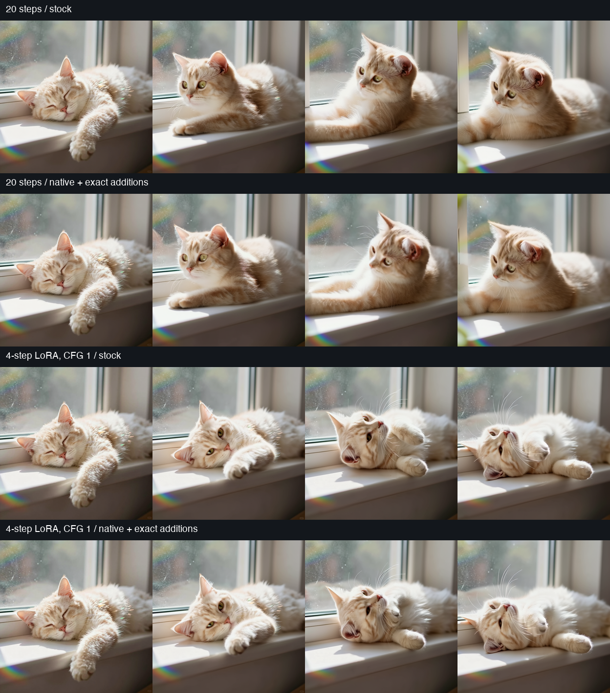

# Wan 2.2 I2V 14B×2 on M5 Ultra

**2026-09-26 · M5 Ultra / 80 GPU cores / 256 GB · macOS 27.0 · PyTorch 2.14.0.**

The original 20-step workflow improves from **423.62 to 302.65 seconds** end to end. Enabling its four-step LoRAs and CFG 1 gives **45.76 → 32.36 seconds**. Both use the full 81-frame clip.

## Frozen workflow and baseline

The source is `video_wan2_2_14B_i2v.json`. Both variants render **512×512,
81 frames at 16 fps**, with Euler / simple sampling and model shift 5. The
reference is `z-image-turbo_00003_.png`, a 1024×1024 sleeping cat. The prompt
is **“The cat wakes up and stretches her paws.”** The original negative prompt
and seed **264244520398999** are retained.

- High/low models: `wan2.2_i2v_high_noise_14B_int8_convrot.safetensors` and
  `wan2.2_i2v_low_noise_14B_int8_convrot.safetensors` in the `wan2.2` folder.
- Text encoder: `umt5_xxl_fp8_e4m3fn_scaled.safetensors`, type `wan`.
- VAE: `wan_2.1_vae.safetensors`, FP16 compute.
- Original: **20 steps, split 10+10, CFG 3.5, LoRAs off**.
- Turbo: **4 steps, split 2+2, CFG 1**, with both matching
  `wan2.2_i2v_lightx2v_4steps_lora_v1_{high,low}_noise.safetensors` LoRAs at
  their saved strength of approximately 1. The workflow's existing switch
  selects these settings; the shared workflow itself is not edited.

Runtime checks confirm four total steps, CFG 1, a 2+2 split, and **400 patched
weight entries in each LoRA model** for the native turbo measurements.

These INT8 checkpoints already contain valid format metadata. **Stock is
unmodified ComfyUI running PyTorch 2.14 with this acceleration node absent**, not a repaired
baseline. Both configurations use PyTorch attention. ComfyUI commit:
`b33e2b55cae074eca5aec96283cceac19aa249ba`; Torch git:
`08187d9e0fba026dc8217405802ab5381dc88d90`.

The benchmark freezes API graphs, model header hashes and sizes, input hash,
runtime/source manifests, and output hashes. One isolated GPU job runs at a
time, with preview disabled and memory watchdogs. The user's normal server
is not restarted. Warm measurements include allocations, layout conversion,
quantization, sampling, complete VAE decode and MP4 export. Model loading,
unchanged text encoding and reference-image encoding are cached. Tensor
hashing, intermediate verification and synchronized profiling run outside
the accepted timing samples.

## Full-workflow results

| Workflow / configuration | End to end | Sampling | VAE decode |
|---|---:|---:|---:|
| 20 steps / stock | 423.624 s | 419.060 s | 4.320 s |
| 20 steps / previous native | 413.573 s | 410.573 s | 2.748 s |
| **20 steps / new exact additions** | 302.645 s | 299.598 s | 2.783 s |
| 4-step LoRA / stock | 45.761 s | 41.267 s | 4.258 s |
| 4-step LoRA / previous native | 44.174 s | 41.142 s | 2.797 s |
| **4-step LoRA / new exact additions** | 32.361 s | 29.324 s | 2.803 s |


Measured end-to-end samples (seconds):

- `stock-full`: [423.469, 423.779] (n=2).
- `turbo-stock`: [45.825, 45.696] (n=2).
- `native-full-baseline`: [413.573] (n=1).
- `native-full-optimized`: [302.404, 302.887] (n=2).
- `turbo-native-baseline`: [44.174] (n=1).
- `turbo-native-optimized`: [32.359, 32.362] (n=2).

Stock discards its first full run. Native discards two full-sequence warmups; for the original workflow these warmups use four ordinary steps at CFG 3.5. The accepted original measurements still use all 20 steps. The first native warmup also checks every transformer block against the old implementation and is excluded from performance results.

The new additions save **110.93 s (26.8%)** relative to the previous native 20-step control, and **11.81 s (26.7%)** with turbo.


Against the user's **111 s M5 Max** reference at **512²×81 frames, four-step LoRAs, CFG 1** (settings confirmed by the user), optimized turbo is **3.43× as fast** and **70.8% shorter**. Its 32.36 s is below the requested 55.5 s target. The Max measurement was supplied by the user; it was not rerun on the unavailable Max or verified against this exact prompt, seed and software build. The stock-versus-optimized Ultra measurements are the controlled comparison.

The four-step LoRA changes the generative process. Its output should be judged
separately from the original 20-step clip; the timing difference between those
variants is not an exact kernel speedup.

## Accepted exact changes

1. **FP16 INT8 projection output fusion.** Wan was using the existing INT32
   matrix multiply followed by materialized scaling, FP16 conversion and bias
   passes. Reuse the existing fused FP16 epilogue: multiply the same FP32 row
   and column scales, rescale the same INT32 dot product, round to FP16, add
   FP16 bias, and round again. The intermediate FP16 rounding is retained.
   This removes large INT32/FP32 output tensors and memory passes without
   changing input quantization, matrix multiplication or arithmetic order.
2. **FP16 query-load caching for self-attention.** Extend the already validated
   PyTorch 2.14 MPP query-cache path to Wan's 40 heads, dimension 128, and batch
   sizes 1 and 2. Keep tile sizes, softmax, reduction order and matrix arithmetic.
   Only query loads move outside the key loop.
3. **Cross-attention and output layout.** Apply the same exact change to Wan's
   512-token text context. Write attention results directly in the layout
   consumed by the projection, avoiding a separate output copy.

Actual captured operator measurements, including output allocation:

| Operation | Previous path | New exact path |
|---|---:|---:|
| INT8 projection, M=10240 / N=5120 / K=5120 | ~5.94 ms | ~2.70 ms |
| INT8 FFN expansion, M=10240 / N=13824 / K=5120 | ~15.7 ms | ~7.07 ms |
| Full self-attention, B=2 / H=40 / S=21504 / D=128 | ~208 ms | ~182 ms |
| Full text cross-attention, including output layout | ~5.36 ms | ~4.08 ms |

The one-second screening workflow (17 frames, four ordinary steps, CFG 3.5,
LoRAs off) averaged **14.962 → 10.108 s** for the prototype. Its controls were
14.926/14.998 s and combined results 10.094/10.122 s. That prototype enabled
self-attention caching; production additionally enables the validated
cross-attention route. Full clips above determine acceptance.

## Exactness and installation

**40 tests pass**, covering FP16 projection output rounding, Parameter biases,
zero/tiny scales, storage offsets, batched/ragged self-attention, cross-attention,
output layouts, unsupported inputs and the earlier BF16 attention routes.
Captured real-model operators match bytes. Direct complete-block checks pass
for **all 80 high/low transformer blocks** on the full original sequence and
again with the four-step LoRAs. The one-second prototype separately checked
80 blocks. Full high-noise latents, final sampler latents and FP32 decoded
frames are byte-identical across each previous-native/new pair, including
every measured repeat. Conditioning and initial noise also match.

The integration checks assert that the new projection kernel actually runs
inside every block. An initial too-strict bias-type guard was caught during
warmup, fixed to accept `torch.nn.Parameter`, and covered by a regression test.
Those aborted warmup timings are not included.

**Stock and the native stack are not byte-identical to each other.** Existing
native paths already change quantized computation and text-encoder placement.
The new additions are exact relative to that unchanged native stack, including
the same turbo LoRAs when enabled. This is not a claim that W8A8 equals W8A16,
or that turbo equals the original sampler.

The existing stock/native differences measured on the saved tensors are:

| Variant | Final latent RMSE | Decoded frame RMSE | Frame PSNR (range 0–1) |
|---|---:|---:|---:|
| original | 0.411431 | 0.065456 | 23.68 dB |
| turbo | 0.287258 | 0.044189 | 27.09 dB |

These are whole-stack differences, including changing motion trajectories, not errors introduced by the new kernels. New-versus-previous-native error is zero. The comparison sheet shows similar color and fine fur detail, but different head/paw positions as the clips progress. Turbo also changes the action relative to the 20-step clip. Saved videos are provided for direct viewing; tensor error alone is not a quality judgment.


The three runtime files are installed in `ComfyUI-AppleSilicon-2.14`.
Their installed hashes match the benchmarked source. Fresh processes using
the installed node pass a one-second original replay and full 81-frame turbo
replays with the ordinary defaults and no candidate wrapper; all tensors
match their accepted native references. **Restart ComfyUI to load the update.**
The original shared workflow is unchanged.

Installed turbo replay samples: [32.406, 32.382] s warm. The first prompt execution, including uncached model/text/reference setup, took 43.854 s; process startup is outside that timer.


These defaults require the validated M5 Ultra / PyTorch build, fast math off,
and the existing native opt-in. No workflow node is added. Unsupported calls
fall back to their preceding implementation. To disable the new additions:

```text
ASFP8_WAN_EXACT=0          # all additions from this investigation
ASFP8_WAN_FP16_GEMM=0      # projection-output fusion only
ASFP8_WAN_ATTN=0           # self- and text-cross-attention additions
ASFP8_WAN_CROSS_ATTN=0     # text-cross-attention addition only
```

The existing `ASFP8_NATIVE=1` and `ASFP8_ATTN_BACKEND=pytorch` settings remain
the normal configuration. LoRA selection and the four-step/CFG-1 settings are
workflow choices, not enabled automatically by any kernel flag.

## Further experiments

| Candidate | Finding and decision |
|---|---|
| INT8 workgroup order / compiler-fence scheduling | All 50 initial variants matched bytes. At full M=43008, best measured changes were ~11.12→11.01 ms and ~29.86→29.70 ms. Follow-up controls exposed small-shape warmup/clock effects. No robust practical gain; keep the existing schedule. |
| Existing FlashAttention 4.1 route | Full attention was ~297 ms versus ~208 ms for PyTorch and ~182 ms for exact query caching; output bytes also differed. Not selected. |
| VAE chunk 4 / 8 / 32 | Repeated decode of the same saved stock latents: default 16 took ~2.77 s; chunk 4 ~3.37 s, chunk 8 ~2.92 s, chunk 32 ~2.69 s. Every alternate size changed final frame bytes. Default 16 retained; no VAE change installed. |

These screens identify useful changes for this workflow, not a proven
hardware limit. They do not substitute isolated kernel timings for complete
render measurements.

## Artifacts



- [20-step stock clip](data/m5-ultra-wan22-20step-stock.mp4)
- [20-step optimized clip](data/m5-ultra-wan22-20step-optimized.mp4)
- [Four-step LoRA stock clip](data/m5-ultra-wan22-turbo-stock.mp4)
- [Four-step LoRA optimized clip](data/m5-ultra-wan22-turbo-optimized.mp4)

Videos are also copied to the shared output folder, under `AppleSilicon-benchmarks/wan22-2026-09-26`. The native reference frames shown in the sheet match the new optimized frames byte for byte.

Frozen ordinary ComfyUI API graphs: [original 20-step workflow](data/m5-ultra-wan22-original.json) and [four-step LoRA workflow](data/m5-ultra-wan22-turbo.json). These use the normal nodes, without benchmark observers.


The [raw benchmark data](data/m5-ultra-wan22.json) contains repeat timings,
graphs, hashes, runtime information, numerical comparisons, test results and
the rejected experiments. Large saved latent/frame tensors remain in the
local `diagnostics/wan22` directory for decoder-only replay.
